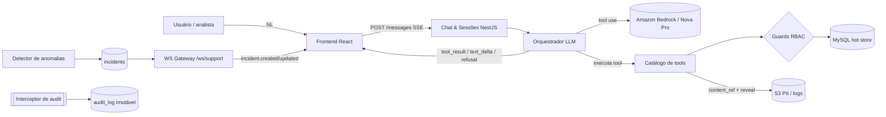

## Architecture Notes

A Atena é o assistente conversacional de IA da plataforma de comunicação. O objetivo é dar a times de suporte autorizados acesso self-service aos dados de envio de SMS (busca, trilha de entrega, análise de risco de conteúdo, relatórios) e, na Fase 2, detectar anomalias proativamente (incidentes, push WebSocket e ciclo de vida com resolução estruturada).

**Estado atual do repositório (sê honesto): só existe DESIGN HANDOFF.** Não há `package.json`, backend nem frontend de produção. O único código real é o protótipo standalone em [`docs/(protótipo original, não incluído)`](../../docs/(protótipo original, não incluído)) — `*.jsx` que servem como **referência de design de alta fidelidade**, não para copiar para produção. Os mocks em `prototype/data.jsx` são o **contrato de shape** que o backend deverá cumprir. Toda a arquitetura abaixo descreve a **direção pretendida** pelo handoff ([README](../../docs/design_handoff_atena/README.md), [01](../../docs/design_handoff_atena/01-backend-api-contract.md), [02](../../docs/design_handoff_atena/02-data-model.md), [03](../../docs/design_handoff_atena/03-websocket-events.md)) — não como código que já existe.

### Os 5 princípios não-negociáveis

Estes princípios (fonte: [README §5](../../docs/design_handoff_atena/README.md)) governam toda decisão de arquitetura:

1. **A IA é intérprete, não executora.** O LLM traduz linguagem natural em uma chamada de tool. É a **aplicação** que roda a query, aplica RBAC e acessa os dados. O LLM recebe de volta só o resultado estruturado — **nunca toca o banco**.
2. **O LLM não fabrica dados.** Todo dado estruturado (telefone, ID, status, número) vem do retorno de uma tool. Pedido sem tool aplicável resulta em **recusa explícita** (componente `RefusalCard` do protótipo).
3. **Mudança de estado de incidente NÃO é tool do LLM.** `acknowledge`/`resolve`/`comment` só acontecem via UI (formulário) com validação server-side, garantindo a integridade do relatório gerencial.
4. **Tudo é auditado.** Mensagens, tool calls, reveals de PII e mudanças de incidente vão para um audit log imutável (retenção 1 ano), implementado como **interceptor global no NestJS**.
5. **PII mascarada por padrão.** Telefone e conteúdo de SMS chegam mascarados; revelar gera entry no audit log.

## System Architecture Overview

A topologia pretendida é um **monólito modular NestJS** (módulos + DI) em TypeScript, com um frontend React separado consumindo a API. Modelo de deploy pretendido: o WS gateway roda atrás de um API Gateway WebSocket gerenciado para escala.

O pivô central de controle é o **orquestrador LLM**: o usuário envia uma mensagem em linguagem natural; o orquestrador chama o **Amazon Bedrock (modelo Nova Pro via Bedrock, Converse API, streaming + tool use)**; quando o LLM decide invocar uma tool, **o controle volta para a aplicação**, que executa a query determinística (aplicando RBAC), devolve o resultado estruturado para o LLM, que então gera o texto da resposta. A resposta volta ao cliente como stream SSE na sequência `tool_call → tool_result → text_delta → done` (ou `refusal`). Detalhes do percurso de uma requisição estão em [data-flow.md](./data-flow.md).

## Architectural Layers

Camadas pretendidas (direção do handoff — ainda não implementadas):

- **Chat & sessões**: cria/lista sessões e recebe mensagens do usuário (`POST /api/chat/sessions/{id}/messages` com stream SSE). Persiste em `chat_sessions` / `chat_messages` (retenção 90d).
- **Orquestrador LLM**: Amazon Bedrock (modelo Nova Pro via Bedrock, Converse API, streaming + tool use). Traduz NL em chamada de tool, executa o loop de tool use e produz `refusal` quando não há tool aplicável. **Nunca acessa o banco diretamente.**
- **Catálogo de tools (Fase 1)**: `search_shippings` (`GET /api/shippings/search`), `get_shipping_trail` (`GET /api/shippings/{id}/trail`), `analyze_shipping_content` (`POST /api/shippings/analyze`), `generate_delivery_report` (`POST /api/reports/delivery`), `list_providers`, `list_customers`. **(Fase 2)**: `list_incidents`, `get_incident`, `generate_incident_report`. Cada tool tem um endpoint REST espelhado (usado pela tool e direto pela UI).
- **Camada de dados — MySQL (só dado da aplicação)**: `incidents`, `incident_activity`, `anomaly_rules`, `chat_sessions`/`chat_messages`, `audit_log`. ORM Prisma, migrations versionadas, retenção 90d (audit log 1 ano). **Atualização (2026-06-18):** o dado de ENTREGA saiu do MySQL — `messages`/`message_events` foram **dropados**; agora vem do **S3 (fonte de verdade) via `AuditQueryService`** (DuckDB embarcado + cache `/tmp`), consultando os logs sob demanda. Ver `.context/plans/audit-query-engine.md`.
- **Cache transitório de conteúdo/trilha — arquivos temporários no `/tmp`**: os dados brutos volumosos derivados dos logs (conteúdo/trilha) são materializados como **arquivos temporários no `/tmp`** do host, montado como **volume de um container Docker** (deploy pretendido: imagem Docker numa EC2, volume → `/tmp` da máquina). Funciona como **cache transitório (read-through) dos dados brutos**: lê do `/tmp`; se faltar, **busca no S3** (origem durável) e popula o `/tmp`. Propósito: (a) evitar muitas requisições ao S3 num curto período e (b) manter os dados brutos fora do banco (não onerar o MySQL). É um cache **efêmero/rebuildável** — nada que precise sobreviver a restart/redeploy mora só aqui (audit e metadados em MySQL, origem do conteúdo em S3).
- **Camada de dados — S3**: conteúdo bruto de SMS/PII (apontado por `content_ref`) e logs originais `json.gz` (~100 GB/mês); Athena para janelas além da retenção. É a **origem durável** que popula o cache transitório de `/tmp` quando o dado pedido não está nele.
- **WebSocket gateway (Fase 2)**: `WS /ws/support`, um canal por usuário autenticado, push de eventos de incidente (`incident.created`, `incident.updated`, `incident.auto_resolved`, `connection.status`).
- **Interceptor global de audit**: intercepta toda ação auditável e escreve entry imutável.
- **Guards de RBAC/Auth**: aplicados por endpoint (`support_analyst` vs. `support_lead`). Auth via login social institucional (OIDC, domínio restrito); o RBAC é mapeado após o login (SSO corporativo completo SAML + SCIM é débito residual, ver [tech-debt.md](./tech-debt.md)).
- **Frontend**: React + TypeScript + styled-components + Phosphor Icons sobre `atena-design-system`, PT-BR informal, layout immersive (sem sidebar).

> Use `context({ action: "getMap", section: "all" })` para o snapshot gerado de arquitetura e dependências. (Hoje o snapshot só enxerga `docs/` — o protótipo de design — porque não há código de produção.)

## Detected Design Patterns

Padrões pretendidos pelo handoff (nenhum implementado ainda; locations citam o handoff ou o protótipo de referência):

| Pattern | Confidence | Locations | Description |
|---------|------------|-----------|-------------|
| Orchestrator / Tool-use loop | Direção | [README §5](../../docs/design_handoff_atena/README.md), [01 §B](../../docs/design_handoff_atena/01-backend-api-contract.md) | IA interpreta NL → tool; a aplicação executa. LLM nunca toca o banco. |
| Interceptor (cross-cutting audit) | Direção | [02 audit_log](../../docs/design_handoff_atena/02-data-model.md), [README §5.4](../../docs/design_handoff_atena/README.md) | Interceptor global NestJS escreve audit log imutável. |
| Guard / RBAC | Direção | [02 §RBAC](../../docs/design_handoff_atena/02-data-model.md) | Guards por endpoint diferenciam `support_analyst` / `support_lead`. |
| Refusal / fail-closed | Direção | `prototype/chat.jsx :: RefusalCard`, [01 §A](../../docs/design_handoff_atena/01-backend-api-contract.md) | Sem tool aplicável → evento `refusal`; LLM não fabrica dados. |
| Masking + reveal-on-demand | Direção | `prototype/tool-results.jsx :: useMaskedPhone`, `ContentRevealBox` | PII mascarada por padrão; reveal gera audit entry. |
| Gateway (WebSocket) | Direção | [03](../../docs/design_handoff_atena/03-websocket-events.md) | WS gateway NestJS para push de incidentes. |
| Repository / ORM | Direção | [02](../../docs/design_handoff_atena/02-data-model.md) | Prisma/Drizzle mapeia o schema (snake_case no DB, camelCase na API). |

## Entry Points

Não há entry point de produção. Os entry points de **referência** são do protótipo:

- [`(protótipo original, não incluído)`](../../(protótipo original, não incluído)) — entry do protótipo (`LOCKED` define layout/densidade/accent/incidentStyle).
- [`(protótipo original, não incluído)`](../../(protótipo original, não incluído)) — tela principal (Composer, ToolCallPill, RefusalCard).
- [`(protótipo original, não incluído)`](../../(protótipo original, não incluído)) — render dos resultados de tool.

Entry points **pretendidos** quando o produto existir: `POST /api/chat/sessions/{id}/messages` (chat com stream) e `WS /ws/support` (push de incidentes).

## Public API

Não há símbolos exportados de produção. A "API pública" pretendida é o contrato REST/WS de [01-backend-api-contract.md](../../docs/design_handoff_atena/01-backend-api-contract.md):

| Symbol | Type | Location |
|--------|------|----------|
| `POST /api/chat/sessions` (+ `/{id}/messages` SSE) | REST endpoint | [01 §A](../../docs/design_handoff_atena/01-backend-api-contract.md) |
| `search_shippings` / `get_shipping_trail` / `analyze_shipping_content` / `generate_delivery_report` / `list_providers` / `list_customers` | LLM tools (Fase 1) | [01 §B](../../docs/design_handoff_atena/01-backend-api-contract.md) |
| `list_incidents` / `get_incident` / `generate_incident_report` | LLM tools (Fase 2) | [01 §B](../../docs/design_handoff_atena/01-backend-api-contract.md) |
| `POST /api/incidents/{id}/acknowledge\|resolve\|comment` | REST (UI-only, não-tool) | [01 §B,§D](../../docs/design_handoff_atena/01-backend-api-contract.md) |
| `GET /api/observability`, `GET /api/audit`, `GET/PUT /api/rules`, `GET/PUT /api/users/me/preferences` | REST endpoints | [01 §E](../../docs/design_handoff_atena/01-backend-api-contract.md), [04](../../docs/design_handoff_atena/04-screen-to-endpoint-map.md) |
| `WS /ws/support` — `incident.created` / `incident.updated` / `incident.auto_resolved` / `connection.status` | WebSocket events | [03](../../docs/design_handoff_atena/03-websocket-events.md) |

## Internal System Boundaries

A fronteira mais importante é entre o **orquestrador LLM** e a **camada de tools**: o LLM só conhece os *schemas* das tools; quem executa query, aplica RBAC e busca dados é a aplicação. Essa separação é o que torna os princípios 1 e 2 verificáveis.

Outras fronteiras pretendidas:
- **Cache transitório (`/tmp`) vs. metadados (MySQL) vs. origem durável (S3)**: os metadados estruturados ficam no MySQL; o conteúdo/PII e os logs ficam no S3, apontados por `content_ref`. Os dados brutos de conteúdo/trilha ficam num cache transitório (read-through) no `/tmp` (volume Docker numa EC2): lê do `/tmp`; se faltar, busca no S3 (`s3_log_pointer`/`content_ref`) e popula o `/tmp` — para evitar muitas requisições ao S3 num curto período e manter os brutos fora do banco. O `/tmp` é cache efêmero/rebuildável; toda leitura de conteúdo passa por um reveal logado.
- **Tools (leitura) vs. mudança de estado de incidente (escrita)**: `acknowledge`/`resolve` são deliberadamente *fora* do catálogo de tools — só via REST com validação server-side (princípio 3).
- **Audit log append-only**: domínio isolado, app role só com INSERT + SELECT (sem UPDATE/DELETE). *Decisão pendente*: tabela no mesmo MySQL vs. serviço dedicado.
- **Tipos compartilhados**: pacote pretendido `@atena/types` para alinhar shapes entre frontend e backend.

## External Service Dependencies

- **Amazon Bedrock (modelo Nova Pro via Bedrock, Converse API, streaming + tool use)**: orquestração do LLM. Preferência por cliente sem retenção de prompt (*decisão pendente*).
- **Auth (Acme)**: login social institucional (OIDC) + RBAC — OIDC via Microsoft 365 (Entra ID), atrás de uma abstração de auth para trocar de IdP facilmente (ex.: Google Workspace), restrito ao domínio `@example.com`, sem senha própria. O token/sessão OIDC vai no Bearer dos endpoints REST e é validado no handshake WS. SSO corporativo completo (SAML + SCIM) é débito residual, ver [tech-debt.md](./tech-debt.md).
- **MySQL**: hot store de metadados (retenção 90d; audit log 1 ano).
- **S3**: conteúdo de SMS/PII + logs `json.gz` (~100 GB/mês); origem durável que popula o cache transitório de `/tmp` (volume Docker numa EC2); **Athena** para consultas além da retenção.
- **API Gateway WebSocket gerenciado**: fronteira de escala do WS gateway em produção.
- **Observabilidade**: OpenTelemetry / Prometheus alimentam `GET /api/observability` (latência por tool p50/p95/p99, tokens, custo, MTTA, recusas, status do WS).
- **Detector de anomalias (Fase 2)**: começa via webhook do Grafana Alertmanager → cria incidente.

## Key Decisions & Trade-offs

- **NestJS** foi escolhido por trazer módulos + DI, WS gateway nativo, guards (auth/RBAC) e interceptors (audit) "de fábrica", alinhados aos princípios não-negociáveis.
- **TypeScript fim a fim** (mesma linguagem do frontend) permite tipos compartilhados (`@atena/types`) e um único time.
- **Threshold-based no MVP**: as regras de anomalia são por threshold, então Node dá conta. Se virar ML pesado, isolar o detector num serviço Python/FastAPI e manter o resto em Node ([README §4](../../docs/design_handoff_atena/README.md)).
- **Banner persistente** para push de incidente (em vez de toast ou painel auto-aberto): alta visibilidade sem interromper o que o analista está fazendo — endereça diretamente a meta de MTTA < 5 min ([decisions.md](../../docs/design_handoff_atena/decisions.md)).
- **Layout immersive** (sem sidebar): o chat é a interface primária ([decisions.md](../../docs/design_handoff_atena/decisions.md)).

## Diagrams

## Risks & Constraints

- **Sem código de produção ainda**: tudo é direção; riscos de implementação ainda não exercitados.
- **PII e conformidade**: telefone/conteúdo são sensíveis; mascaramento por padrão e reveal logado são obrigatórios. *Decisão pendente*: conteúdo em claro no cache transitório de `/tmp` vs. só no S3.
- **Imutabilidade do audit log**: precisa de garantia de banco (sem UPDATE/DELETE), idealmente tabela append-only particionada por mês.
- **Escala do WS**: ~100 GB/mês de logs e push em tempo real exigem o API Gateway WS gerenciado.
- **Latência/custo do LLM**: streaming + tool use têm custo por token; observabilidade precisa monitorar p50/p95/p99 e consumo.
- **Decisões pendentes que travam**: política de PII, top-3 cenários de anomalia, onde mora o audit log ([decisions.md](../../docs/design_handoff_atena/decisions.md)). (LLM já batido em Amazon Bedrock; auth via login social institucional (OIDC, domínio restrito), com SSO corporativo completo SAML + SCIM como débito residual — ver [tech-debt.md](./tech-debt.md).)

## Top Directories Snapshot

- [`docs/design_handoff_atena/`](../../docs/design_handoff_atena/) — pacote de handoff (specs `01`–`06`, `decisions.md`, `spec-assistente-suporte.md`, `screenshots/`, `prototype/`). Único conteúdo real do repo.
- `docs/(protótipo original, não incluído)` — ~14 arquivos `.jsx` (protótipo de design de referência: `app`, `login`, `chat`, `incidents`, `history`, `rules`, `audit`, `observability`, `shells`, `error-states`, `tool-results`, `ui`, `data`, `tweaks-panel`).
- `.context/` — scaffolding de contexto (docs, agents, skills, harness).
- _Sem diretórios de produção_ (`src/`, backend, frontend) — ainda não existem.

## Related Resources

- [Project Overview](./project-overview.md)
- [Data Flow & Integrations](./data-flow.md)
- [Development Workflow](./development-workflow.md)
- [Glossary & Domain Concepts](./glossary.md)
- Handoff: [README](../../docs/design_handoff_atena/README.md) · [01 — API Contract](../../docs/design_handoff_atena/01-backend-api-contract.md) · [02 — Data Model](../../docs/design_handoff_atena/02-data-model.md) · [03 — WebSocket Events](../../docs/design_handoff_atena/03-websocket-events.md)
