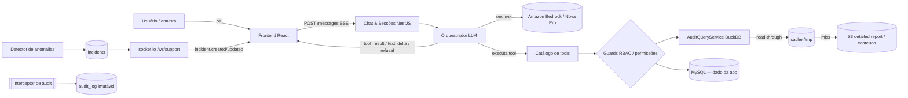

## Architecture Notes

A Atena é o assistente conversacional de IA da plataforma de comunicação. O objetivo é dar a times de suporte autorizados acesso self-service aos dados de envio de SMS (busca, trilha de entrega, análise de risco de conteúdo, relatórios) e detectar anomalias proativamente (incidentes, push realtime e ciclo de vida com resolução estruturada).

**Estado atual do repositório: MVP implementado.** O produto está construído como **monorepo npm** — `apps/api` (NestJS 11 + Prisma/MySQL), `apps/web` (React 18 + Vite) e `packages/types` (`@atena/types`). A arquitetura abaixo descreve **o que existe**. O pacote em [`docs/design_handoff_atena/`](../../docs/design_handoff_atena/) (specs + protótipo `*.jsx`) permanece como **referência histórica de design/contrato** — note que a API real serializa em `snake_case` (revisão do handoff, ver [code-style.md](./code-style.md)).

### Os 5 princípios não-negociáveis

Estes princípios (fonte: [README §5](../../docs/design_handoff_atena/README.md)) governam toda decisão de arquitetura:

1. **A IA é intérprete, não executora.** O LLM traduz linguagem natural em uma chamada de tool. É a **aplicação** que roda a query, aplica RBAC e acessa os dados. O LLM recebe de volta só o resultado estruturado — **nunca toca o banco**.
2. **O LLM não fabrica dados.** Todo dado estruturado (telefone, ID, status, número) vem do retorno de uma tool. Pedido sem tool aplicável resulta em **recusa explícita** (componente `RefusalCard` do protótipo).
3. **Mudança de estado de incidente NÃO é tool do LLM.** `acknowledge`/`resolve`/`comment` só acontecem via UI (formulário) com validação server-side, garantindo a integridade do relatório gerencial.
4. **Tudo é auditado.** Mensagens, tool calls, reveals de PII e mudanças de incidente vão para um audit log imutável (retenção 1 ano), implementado como **interceptor global no NestJS**.
5. **PII mascarada por padrão.** Telefone e conteúdo de SMS chegam mascarados; revelar gera entry no audit log.

## System Architecture Overview

A topologia é um **monólito modular NestJS** (módulos + DI) em TypeScript, com um frontend React (Vite) separado consumindo a API sob o prefixo `/api`.

O pivô central de controle é o **orquestrador LLM**: o usuário envia uma mensagem em linguagem natural; o orquestrador chama o **Amazon Bedrock (Amazon Nova Pro `us.amazon.nova-pro-v1:0`, Converse API, streaming + tool use)**; quando o LLM decide invocar uma tool, **o controle volta para a aplicação**, que executa a query determinística (aplicando RBAC), devolve o resultado estruturado para o LLM, que então gera o texto da resposta. A resposta volta ao cliente como stream SSE na sequência `tool_call → tool_result → text_delta → done` (ou `refusal`); o `ThinkingSplitter` separa as tags `<thinking>` inline emitidas pelo Nova. Sem credencial, um **provider fake** determinístico assume. Detalhes do percurso de uma requisição estão em [data-flow.md](./data-flow.md).

## Architectural Layers

Camadas implementadas (módulos em `apps/api/src`):

- **Chat & sessões** (`chat/`): cria/lista sessões e recebe mensagens do usuário com stream SSE. Persiste em `chat_sessions` / `chat_messages` (retenção configurável, default 90d, via módulo `retention/`).
- **Orquestrador LLM** (`chat/orchestrator.service.ts` + `llm/`): Amazon Nova Pro via Bedrock Converse (provider `BedrockProvider`; fallback `FakeLlmProvider`). Traduz NL em chamada de tool, executa o loop de tool use e produz `refusal` quando não há tool aplicável. **Nunca acessa o banco diretamente.**
- **Catálogo de tools**: `search_shippings` (`GET /api/shippings/search`), `get_shipping_trail` (`GET /api/shippings/:id/trail`), `analyze_shipping_content` (`POST /api/shippings/analyze`), `generate_delivery_report` (`POST /api/reports/delivery`), `list_providers`, `list_customers`; e de incidente: `list_incidents`, `get_incident`, `generate_incident_report`. Cada tool tem endpoint REST espelhado (usado pela tool e direto pela UI).
- **Dado de ENTREGA — S3 (fonte da verdade) via `AuditQueryService`** (`audit-query/`): o dado de entrega **não fica no MySQL**. As tabelas `messages`/`message_events` foram **dropadas**; o `DuckDbAuditQueryService` (token `AUDIT_QUERY`) consulta o **detailed report no S3** (`s3://example-sms-delivery-reports`) **sob demanda** com **DuckDB embarcado** + cache parquet no `/tmp`. Grão por destinatário `(campaign_id, phone)`, `id = md5(campaign_id||'|'||phone)`, telefone só-dígitos. Canal `CHANNEL_FILTER IN ('sms','sms_flash')`; `app_id` materializado. Janela por **ENVIO** (`requested_at`) com **scan simétrico** ±`lateStatusBuffer` (default 48–72h) para captar status tardios e o `queued` de envios anteriores ao `from`. Fuso de exibição BRT (`APP_TIMEZONE`, UTC-3); motor em UTC, convertendo só nas bordas.
- **Camada de dados — MySQL (só dado da aplicação)** (`prisma/`): `incidents`, `incident_activity`, `anomaly_rules`, `chat_sessions`/`chat_messages`/`chat_session_incidents`, `audit_log`, `users`/`user_roles`, `audit_scan_events`. ORM Prisma, migrations versionadas. Audit log append-only.
- **Cache transitório (`/tmp`)** (`cache/`): dados brutos volumosos derivados do detailed report materializados como **arquivos temporários no `/tmp`** (volume Docker numa EC2 em prod). Cache **read-through**: lê do `/tmp`; se faltar, busca no S3 e popula. **Efêmero/rebuildável** — nada durável mora só aqui (audit/metadados em MySQL, origem dos brutos em S3). Eviction por idade+tamanho (`ATENA_AUDIT_CACHE_MAX_MB`/`_MAX_AGE_HOURS`).
- **Gateway realtime** (`realtime/`): **socket.io** em `/ws/support`, um canal por usuário autenticado (sessão por cookie JWT validada no handshake), push de eventos de incidente (`incident.created`, `incident.updated`, `incident.auto_resolved`, `connection.status`).
- **Detector de anomalias** (`detector/`): regras `delivery_rate_drop`, `failure_spike`, `consistent_error`, `webhook_silence`; cria `incidents` (com `related_shipping_ids`); suporta **shadow mode** (detecta+registra, não notifica). Scan agendado (`DETECT_ENABLED`) + gatilho dev `POST /api/dev/detect`.
- **Interceptor global de audit** (`audit/`): intercepta toda ação auditável (`@Audit`) e escreve entry imutável.
- **Guards de RBAC/Auth** (`auth/`): `AuthGuard` + guard de permissões (`@Requires(perm)`), globais. Auth OIDC Microsoft Entra; **papéis lidos do banco** (não do IdP).
- **Admin & usuários** (`admin/`, `users/`): persistência do usuário no login (upsert), atribuição de papéis por admin (`/admin/usuarios`), gate `access_pending`/`access_disabled`, bootstrap por `AUTH_ADMIN_EMAILS`.
- **Observabilidade** (`observability/`): métricas de tokens/custo/latência por tool, reveals, conexões WS — via DogStatsD (Datadog, opcional).
- **Frontend** (`apps/web`): React 18 + Vite + Phosphor Icons + CSS (design-system com tokens), PT-BR informal, layout immersive (sem sidebar). A entidade de entrega aparece como **"Envio"**.

> Use `context({ action: "getMap", section: "all" })` para o snapshot gerado de arquitetura e dependências.

## Detected Design Patterns

Padrões em uso (locations citam o código real):

| Pattern | Confidence | Locations | Description |
|---------|------------|-----------|-------------|
| Orchestrator / Tool-use loop | Implementado | `apps/api/src/chat/orchestrator.service.ts`, `llm/` | IA interpreta NL → tool; a aplicação executa. LLM nunca toca o banco. |
| Interceptor (cross-cutting audit) | Implementado | `apps/api/src/audit/` (`@Audit` + interceptor global) | Interceptor global NestJS escreve audit log imutável. |
| Guard / RBAC (permissões) | Implementado | `apps/api/src/auth/` (`@Requires`, `rbac/permissions.ts`) | Guards por endpoint exigem permissões; papéis lidos do banco. |
| Refusal / fail-closed | Implementado | `apps/api/src/chat/`, front `chat/` (RefusalCard) | Sem tool aplicável → evento `refusal`; LLM não fabrica dados. |
| Masking + reveal-on-demand | Implementado | `apps/api/src/shippings/reveal.service.ts` | PII mascarada por padrão; reveal exige `pii:reveal` e gera audit. |
| Gateway (socket.io) | Implementado | `apps/api/src/realtime/support.gateway.ts` | Gateway socket.io para push de incidentes. |
| Repository / ORM | Implementado | `apps/api/prisma/schema.prisma` | Prisma mapeia o schema (snake_case no DB). |
| Query engine externo (DuckDB sobre S3) | Implementado | `apps/api/src/audit-query/` | Dado de entrega consultado sob demanda; cache transitório no `/tmp`. |

## Entry Points

- **Backend:** `apps/api/src/main.ts` — bootstrap NestJS (prefixo `/api`, `ValidationPipe`/filtros/interceptors globais, SSE no chat, gateway socket.io `/ws/support`). `apps/api/src/tracing.ts` é importado primeiro (dd-trace, opcional).
- **Frontend:** `apps/web/src/main.tsx` / `apps/web/src/App.tsx` — entry React (roteamento das telas, gate de auth/permissão).
- **Chat (request principal):** `POST /api/chat/sessions/:id/messages` (stream SSE) e `WS /ws/support` (push de incidentes).

## Public API

Superfície REST/WS real (controllers em `apps/api/src/*`, sob prefixo `/api`):

| Symbol | Type | Location |
|--------|------|----------|
| `POST /api/chat/sessions` (+ `/:id/messages` SSE) | REST endpoint | `apps/api/src/chat/` |
| `GET /api/shippings/search` / `/:id/trail` / `POST /analyze` / `/:id/reveal-phone` / `/:id/reveal-content` / `GET /export` | REST (tools + reveal + CSV) | `apps/api/src/shippings/` |
| `search_shippings` / `get_shipping_trail` / `analyze_shipping_content` / `generate_delivery_report` / `list_providers` / `list_customers` / `list_incidents` / `get_incident` / `generate_incident_report` | LLM tools | `apps/api/src/chat/orchestrator.service.ts` |
| `POST /api/incidents/:id/acknowledge\|resolve\|comment` | REST (UI-only, não-tool) | `apps/api/src/incidents/` |
| `GET /api/observability`, `GET /api/audit`, `GET/PUT /api/rules`, `POST /api/reports/delivery\|incidents` | REST endpoints | `apps/api/src/{observability,audit,rules,reports}/` |
| `/api/auth/*` (login/callback/me/logout), `/api/admin/*` (usuários/papéis) | REST endpoints | `apps/api/src/{auth,admin}/` |
| `WS /ws/support` — `incident.created` / `incident.updated` / `incident.auto_resolved` / `connection.status` | socket.io events | `apps/api/src/realtime/` |

## Internal System Boundaries

A fronteira mais importante é entre o **orquestrador LLM** e a **camada de tools**: o LLM só conhece os *schemas* das tools; quem executa query, aplica RBAC e busca dados é a aplicação. Essa separação é o que torna os princípios 1 e 2 verificáveis.

Outras fronteiras:
- **Cache transitório (`/tmp`) vs. dado da app (MySQL) vs. origem durável (S3)**: o dado da aplicação (chat, incidentes, regras, audit, usuários) fica no MySQL; o dado de **ENTREGA** e o conteúdo/PII vêm do **detailed report no S3** (`s3://example-sms-delivery-reports`). Os dados brutos consultados ficam num cache transitório (read-through) no `/tmp`: lê do `/tmp`; se faltar, busca no S3 e popula. O `/tmp` é cache efêmero/rebuildável; toda leitura de conteúdo passa por um reveal logado (`pii:reveal`).
- **Tools (leitura) vs. mudança de estado de incidente (escrita)**: `acknowledge`/`resolve`/`comment` são deliberadamente *fora* do catálogo de tools — só via REST com validação server-side (princípio 3).
- **Audit log append-only**: domínio isolado, app role só com INSERT + SELECT (sem UPDATE/DELETE).
- **Tipos compartilhados**: pacote `@atena/types` (`packages/types`) alinha shapes entre frontend e backend.

## External Service Dependencies

- **Amazon Bedrock (Amazon Nova Pro `us.amazon.nova-pro-v1:0`, Converse API, streaming + tool use)**: orquestração do LLM. Auth via `AWS_BEARER_TOKEN_BEDROCK` (ou IAM role da EC2). Sem credencial → provider fake determinístico.
- **Auth (Microsoft Entra)**: OIDC (state/nonce/PKCE) via Microsoft 365 (Entra ID), atrás de uma abstração `IdentityProviderInterface` (trocável de IdP), restrito ao domínio `@example.com`, sem senha própria. Sessão **stateless por cookie JWT** (`atena_session`, `SameSite=None; Secure; HttpOnly`), validada nos endpoints REST e no handshake socket.io. **Papéis lidos do banco** (não do IdP). SSO corporativo completo (SAML + SCIM) é débito residual, ver [tech-debt.md](./tech-debt.md).
- **MySQL**: store da aplicação (chat, incidentes, regras, audit log, usuários/papéis).
- **S3 (`s3://example-sms-delivery-reports`)**: detailed report de SMS (fonte da verdade da entrega) + conteúdo bruto/PII; origem durável que popula o cache transitório de `/tmp`. Consultado por DuckDB embarcado.
- **Observabilidade (opcional)**: Datadog APM (dd-trace) + métricas via DogStatsD (hot-shots) alimentam `GET /api/observability` (latência/uso por tool, tokens, custo, recusas, conexões WS). Opt-in (`make datadog`); **não** usa OpenTelemetry/Prometheus.
- **Realtime**: socket.io (`socket.io-client` no front), sem API Gateway WebSocket gerenciado no MVP.

## Key Decisions & Trade-offs

- **NestJS** foi escolhido por trazer módulos + DI, guards (auth/RBAC) e interceptors (audit) "de fábrica", alinhados aos princípios não-negociáveis.
- **TypeScript fim a fim** (mesma linguagem do frontend) permite tipos compartilhados (`@atena/types`) e um único time.
- **Dado de entrega fora do banco**: consultado sob demanda do detailed report no S3 via DuckDB + cache `/tmp`, em vez de hot store em MySQL — evita ingestão pesada e mantém o MySQL enxuto (só dado da app).
- **`snake_case` na borda da API** (revisão do handoff, que era camelCase) — ver [code-style.md](./code-style.md).
- **Banner persistente** para push de incidente (em vez de toast ou painel auto-aberto): alta visibilidade sem interromper o analista — endereça a meta de MTTA < 5 min ([decisions.md](../../docs/design_handoff_atena/decisions.md)).
- **Layout immersive** (sem sidebar): o chat é a interface primária ([decisions.md](../../docs/design_handoff_atena/decisions.md)).

## Diagrams

## Risks & Constraints

- **PII e conformidade**: telefone/conteúdo são sensíveis; mascaramento por padrão e reveal logado (`pii:reveal`) são obrigatórios. Conteúdo bruto vive no S3; o `/tmp` é cache efêmero.
- **Imutabilidade do audit log**: garantida por permissão de app role (só INSERT + SELECT).
- **Sessão JWT stateless**: sem revogação central do cookie antes do `exp` (8h); a revogação de **papéis** já é imediata (cache curto + lookup no banco). Ver [tech-debt.md](./tech-debt.md).
- **Latência/custo do LLM**: streaming + tool use têm custo por token; observabilidade monitora uso/latência por tool. Hang intermitente do turno pós-tool no Bedrock (mitigado por idle timeout) — ver [tech-debt.md](./tech-debt.md).
- **Cache `/tmp`**: pré-aquecimento pós-redeploy ainda pendente; cold scan amplo no catálogo é lento (mitigado por janela). Ver [tech-debt.md](./tech-debt.md).
- **Frentes residuais**: SAML/SCIM, IAM Role da EC2 para o S3, FK das tabelas legadas para `users` — ver [tech-debt.md](./tech-debt.md).

## Top Directories Snapshot

- `apps/api/` — backend NestJS 11 (módulos por feature em `src/`, `prisma/schema.prisma`).
- `apps/web/` — frontend React 18 + Vite (features em `src/`).
- `packages/types/` — `@atena/types` (contrato compartilhado).
- [`docs/design_handoff_atena/`](../../docs/design_handoff_atena/) — pacote de handoff (specs `01`–`06`, `decisions.md`, `spec-assistente-suporte.md`, `screenshots/`, `prototype/`). **Referência histórica** de design/contrato.
- `.context/` — scaffolding de contexto (docs, agents, skills, harness).

## Related Resources

- [Project Overview](./project-overview.md)
- [Data Flow & Integrations](./data-flow.md)
- [Development Workflow](./development-workflow.md)
- [Glossary & Domain Concepts](./glossary.md)
- Handoff: [README](../../docs/design_handoff_atena/README.md) · [01 — API Contract](../../docs/design_handoff_atena/01-backend-api-contract.md) · [02 — Data Model](../../docs/design_handoff_atena/02-data-model.md) · [03 — WebSocket Events](../../docs/design_handoff_atena/03-websocket-events.md)
