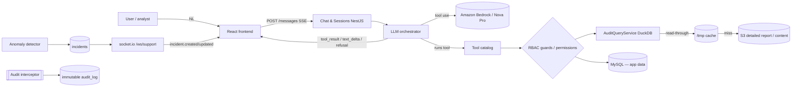

## Architecture Notes

Atena is the conversational AI assistant of the communication platform. Its goal is to give authorized support teams self-service access to SMS sending data (search, delivery trail, content risk analysis, reports) and to detect anomalies proactively (incidents, realtime push, and a lifecycle with structured resolution).

**Current state of the repository: MVP implemented.** The product is built as an **npm monorepo** — `apps/api` (NestJS 11 + Prisma/MySQL), `apps/web` (React 18 + Vite) and `packages/types` (`@atena/types`). The architecture below describes **what exists**. The package in [`docs/design_handoff_atena/`](../../docs/design_handoff_atena/) (specs; the `*.jsx` prototype is no longer in the repository) remains as a **historical design/contract reference** — note that the real API serializes in `snake_case` (a revision of the handoff, see [code-style.md](./code-style.md)).

### The 5 non-negotiable principles

These principles (source: [README §5](../../docs/design_handoff_atena/README.md)) govern every architecture decision:

1. **The AI is an interpreter, not an executor.** The LLM translates natural language into a tool call. It is the **application** that runs the query, applies RBAC and accesses the data. The LLM only receives the structured result back — **it never touches the database**.
2. **The LLM does not fabricate data.** All structured data (phone, ID, status, number) comes from a tool's return value. A request with no applicable tool results in an **explicit refusal** (the prototype's `RefusalCard` component).
3. **Incident state changes are NOT an LLM tool.** `acknowledge`/`resolve`/`comment` only happen through the UI (form) with server-side validation, guaranteeing the integrity of the management report.
4. **Everything is audited.** Messages, tool calls, PII reveals and incident changes go to an immutable audit log (1-year retention), implemented as a **global interceptor in NestJS**.
5. **PII masked by default.** Phone and SMS content arrive masked; revealing them creates an audit log entry.

## System Architecture Overview

The topology is a **NestJS modular monolith** (modules + DI) in TypeScript, with a separate React (Vite) frontend consuming the API under the `/api` prefix.

The central control pivot is the **LLM orchestrator**: the user sends a natural-language message; the orchestrator calls **Amazon Bedrock (Amazon Nova Pro `us.amazon.nova-pro-v1:0`, Converse API, streaming + tool use)**; when the LLM decides to invoke a tool, **control returns to the application**, which runs the deterministic query (applying RBAC) and returns the structured result to the LLM, which then generates the response text. The response goes back to the client as an SSE stream in the sequence `tool_call → tool_result → text_delta → done` (or `refusal`); the `ThinkingSplitter` separates the inline `<thinking>` tags emitted by Nova. Without credentials, a deterministic **fake provider** takes over. Details of a request's path are in [data-flow.md](./data-flow.md).

## Architectural Layers

Implemented layers (modules in `apps/api/src`):

- **Chat & sessions** (`chat/`): creates/lists sessions and receives user messages with an SSE stream. Persists to `chat_sessions` / `chat_messages` (configurable retention, default 90d, via the `retention/` module).
- **LLM orchestrator** (`chat/orchestrator.service.ts` + `llm/`): Amazon Nova Pro via Bedrock Converse (provider `BedrockProvider`; fallback `FakeLlmProvider`). Translates NL into a tool call, runs the tool-use loop and produces a `refusal` when no tool applies. **Never accesses the database directly.**
- **Tool catalog**: `search_shippings` (`GET /api/shippings/search`), `get_shipping_trail` (`GET /api/shippings/:id/trail`), `analyze_shipping_content` (`POST /api/shippings/analyze`), `generate_delivery_report` (`POST /api/reports/delivery`), `list_providers`, `list_customers`; and for incidents: `list_incidents`, `get_incident`, `generate_incident_report`. Each tool has a mirrored REST endpoint (used by the tool and directly by the UI).
- **DELIVERY data — S3 (source of truth) via `AuditQueryService`** (`audit-query/`): delivery data **does not live in MySQL**. The `messages`/`message_events` tables were **dropped**; `DuckDbAuditQueryService` (token `AUDIT_QUERY`) queries the **detailed report in S3** (`s3://example-sms-delivery-reports`) **on demand** with **embedded DuckDB** + a parquet cache in `/tmp`. Per-recipient grain `(campaign_id, phone)`, `id = md5(campaign_id||'|'||phone)`, digits-only phone. Channel `CHANNEL_FILTER IN ('sms','sms_flash')`; `app_id` materialized. Window by **SEND** (`requested_at`) with a **symmetric scan** ±`lateStatusBuffer` (default 48–72h) to capture late statuses and the `queued` of sends prior to `from`. Display time zone BRT (`APP_TIMEZONE`, UTC-3); the engine runs in UTC, converting only at the edges.
- **Data layer — MySQL (application data only)** (`prisma/`): `incidents`, `incident_activity`, `anomaly_rules`, `chat_sessions`/`chat_messages`/`chat_session_incidents`, `audit_log`, `users`/`user_roles`, `audit_scan_events`. Prisma ORM, versioned migrations. Append-only audit log.
- **Transient cache (`/tmp`)** (`cache/`): bulky raw data derived from the detailed report, materialized as **temporary files in `/tmp`** (a Docker volume on an EC2 instance in prod). **Read-through** cache: reads from `/tmp`; on a miss, fetches from S3 and populates it. **Ephemeral/rebuildable** — nothing durable lives only here (audit/metadata in MySQL, raw data origin in S3). Eviction by age+size (`ATENA_AUDIT_CACHE_MAX_MB`/`_MAX_AGE_HOURS`).
- **Realtime gateway** (`realtime/`): **socket.io** at `/ws/support`, one channel per authenticated user (JWT cookie session validated at the handshake), push of incident events (`incident.created`, `incident.updated`, `incident.auto_resolved`, `connection.status`).
- **Anomaly detector** (`detector/`): rules `delivery_rate_drop`, `failure_spike`, `consistent_error`, `webhook_silence`; creates `incidents` (with `related_shipping_ids`); supports **shadow mode** (detects+records, does not notify). Scheduled scan (`DETECT_ENABLED`) + dev trigger `POST /api/dev/detect`.
- **Global audit interceptor** (`audit/`): intercepts every auditable action (`@Audit`) and writes an immutable entry.
- **RBAC/Auth guards** (`auth/`): `AuthGuard` + permissions guard (`@Requires(perm)`), both global. Microsoft Entra OIDC auth; **roles read from the database** (not from the IdP).
- **Admin & users** (`admin/`, `users/`): user persistence at login (upsert), role assignment by an admin (`/admin/usuarios`), `access_pending`/`access_disabled` gate, bootstrap via `AUTH_ADMIN_EMAILS`.
- **Observability** (`observability/`): token/cost/latency metrics per tool, reveals, WS connections — via DogStatsD (Datadog, optional).
- **Frontend** (`apps/web`): React 18 + Vite + Phosphor Icons + CSS (design system with tokens), informal PT-BR, immersive layout (no sidebar). The delivery entity appears as **"Envio"** (Shipping).

> Use `context({ action: "getMap", section: "all" })` for the generated architecture and dependency snapshot.

## Layer rules

Checked by `npm run check:architecture` (dependency-cruiser, `.dependency-cruiser.cjs`), a CI job:

| Rule | Why |
| --- | --- |
| `packages/types` imports nothing | It is the API contract: plain types, no runtime dependency, no app code |
| `apps/api` and `apps/web` never import each other | They meet only at the HTTP contract in `@atena/types` |
| API `src/common` and `src/config` import no feature module | Every feature depends on them; a reverse import would create cycles and hidden coupling |
| Only Nest modules import controllers | Controllers are the thin HTTP edge; logic lives in services |
| API DTOs import only DTOs and `src/common` | A DTO describes a request shape with validation decorators, nothing else |
| Web `src/api` and `src/util` never import a component (`.tsx`) | The data layer and helpers sit below the UI |
| Web `src/util` imports no feature module | Pure helpers used everywhere |
| No cycles, no orphans (entry points, tests and declaration files excepted), no production import of a test | Load order must not matter; dead files are found |

## Detected Design Patterns

Patterns in use (locations cite the real code):

| Pattern | Confidence | Locations | Description |
|---------|------------|-----------|-------------|
| Orchestrator / Tool-use loop | Implemented | `apps/api/src/chat/orchestrator.service.ts`, `llm/` | AI interprets NL → tool; the application executes. The LLM never touches the database. |
| Interceptor (cross-cutting audit) | Implemented | `apps/api/src/audit/` (`@Audit` + global interceptor) | Global NestJS interceptor writes the immutable audit log. |
| Guard / RBAC (permissions) | Implemented | `apps/api/src/auth/` (`@Requires`, `rbac/permissions.ts`) | Per-endpoint guards require permissions; roles read from the database. |
| Refusal / fail-closed | Implemented | `apps/api/src/chat/`, front `chat/` (RefusalCard) | No applicable tool → `refusal` event; the LLM does not fabricate data. |
| Masking + reveal-on-demand | Implemented | `apps/api/src/shippings/reveal.service.ts` | PII masked by default; reveal requires `pii:reveal` and creates an audit entry. |
| Gateway (socket.io) | Implemented | `apps/api/src/realtime/support.gateway.ts` | socket.io gateway for incident push. |
| Repository / ORM | Implemented | `apps/api/prisma/schema.prisma` | Prisma maps the schema (snake_case in the DB). |
| External query engine (DuckDB over S3) | Implemented | `apps/api/src/audit-query/` | Delivery data queried on demand; transient cache in `/tmp`. |

## Entry Points

- **Backend:** `apps/api/src/main.ts` — NestJS bootstrap (`/api` prefix, global `ValidationPipe`/filters/interceptors, SSE in the chat, socket.io gateway `/ws/support`). `apps/api/src/tracing.ts` is imported first (dd-trace, optional).
- **Frontend:** `apps/web/src/main.tsx` / `apps/web/src/App.tsx` — React entry (screen routing, auth/permission gate).
- **Chat (main request):** `POST /api/chat/sessions/:id/messages` (SSE stream) and `WS /ws/support` (incident push).

## Public API

Real REST/WS surface (controllers in `apps/api/src/*`, under the `/api` prefix):

| Symbol | Type | Location |
|--------|------|----------|
| `POST /api/chat/sessions` (+ `/:id/messages` SSE) | REST endpoint | `apps/api/src/chat/` |
| `GET /api/shippings/search` / `/:id/trail` / `POST /analyze` / `/:id/reveal-phone` / `/:id/reveal-content` / `GET /export` | REST (tools + reveal + CSV) | `apps/api/src/shippings/` |
| `search_shippings` / `get_shipping_trail` / `analyze_shipping_content` / `generate_delivery_report` / `list_providers` / `list_customers` / `list_incidents` / `get_incident` / `generate_incident_report` | LLM tools | `apps/api/src/chat/orchestrator.service.ts` |
| `POST /api/incidents/:id/acknowledge\|resolve\|comment` | REST (UI-only, not a tool) | `apps/api/src/incidents/` |
| `GET /api/observability`, `GET /api/audit`, `GET/PUT /api/rules`, `POST /api/reports/delivery\|incidents` | REST endpoints | `apps/api/src/{observability,audit,rules,reports}/` |
| `/api/auth/*` (login/callback/me/logout), `/api/admin/*` (users/roles) | REST endpoints | `apps/api/src/{auth,admin}/` |
| `WS /ws/support` — `incident.created` / `incident.updated` / `incident.auto_resolved` / `connection.status` | socket.io events | `apps/api/src/realtime/` |

## Internal System Boundaries

The most important boundary is between the **LLM orchestrator** and the **tool layer**: the LLM only knows the tools' *schemas*; the application is what runs queries, applies RBAC and fetches data. This separation is what makes principles 1 and 2 verifiable.

Other boundaries:
- **Transient cache (`/tmp`) vs. app data (MySQL) vs. durable origin (S3)**: application data (chat, incidents, rules, audit, users) lives in MySQL; **DELIVERY** data and content/PII come from the **detailed report in S3** (`s3://example-sms-delivery-reports`). The queried raw data sits in a transient (read-through) cache in `/tmp`: read from `/tmp`; on a miss, fetch from S3 and populate. `/tmp` is an ephemeral/rebuildable cache; every content read goes through a logged reveal (`pii:reveal`).
- **Tools (read) vs. incident state change (write)**: `acknowledge`/`resolve`/`comment` are deliberately *outside* the tool catalog — only via REST with server-side validation (principle 3).
- **Append-only audit log**: isolated domain, the app role has only INSERT + SELECT (no UPDATE/DELETE).
- **Shared types**: the `@atena/types` package (`packages/types`) aligns shapes between frontend and backend.

## External Service Dependencies

- **Amazon Bedrock (Amazon Nova Pro `us.amazon.nova-pro-v1:0`, Converse API, streaming + tool use)**: LLM orchestration. Auth via `AWS_BEARER_TOKEN_BEDROCK` (or the EC2 IAM role). No credentials → deterministic fake provider.
- **Auth (Microsoft Entra)**: OIDC (state/nonce/PKCE) via Microsoft 365 (Entra ID), behind an `IdentityProviderInterface` abstraction (IdP-swappable), restricted to the `@example.com` domain, with no password of its own. **Stateless JWT cookie session** (`atena_session`, `SameSite=None; Secure; HttpOnly`), validated on REST endpoints and at the socket.io handshake. **Roles read from the database** (not from the IdP). Full corporate SSO (SAML + SCIM) is residual debt, see [tech-debt.md](./tech-debt.md).
- **MySQL**: application store (chat, incidents, rules, audit log, users/roles).
- **S3 (`s3://example-sms-delivery-reports`)**: SMS detailed report (delivery source of truth) + raw content/PII; the durable origin that populates the transient `/tmp` cache. Queried by embedded DuckDB.
- **Observability (optional)**: Datadog APM (dd-trace) + metrics via DogStatsD (hot-shots) feed `GET /api/observability` (latency/usage per tool, tokens, cost, refusals, WS connections). Opt-in (`make datadog`); does **not** use OpenTelemetry/Prometheus.
- **Realtime**: socket.io (`socket.io-client` on the front), no managed API Gateway WebSocket in the MVP.

## Key Decisions & Trade-offs

- **NestJS** was chosen because it brings modules + DI, guards (auth/RBAC) and interceptors (audit) "out of the box", aligned with the non-negotiable principles.
- **End-to-end TypeScript** (same language as the frontend) allows shared types (`@atena/types`) and a single team.
- **Delivery data outside the database**: queried on demand from the detailed report in S3 via DuckDB + `/tmp` cache, instead of a hot store in MySQL — avoids heavy ingestion and keeps MySQL lean (app data only). See [ADR 0001](./adr/0001-delivery-data-from-s3-through-duckdb.md).
- **`snake_case` at the API edge** (a revision of the handoff, which was camelCase) — see [code-style.md](./code-style.md) and [ADR 0002](./adr/0002-snake-case-at-the-api-edge.md).
- **Persistent banner** for incident push (instead of a toast or an auto-opened panel): high visibility without interrupting the analyst — addresses the MTTA < 5 min goal ([decisions.md](../../docs/design_handoff_atena/decisions.md)).
- **Immersive layout** (no sidebar): the chat is the primary interface ([decisions.md](../../docs/design_handoff_atena/decisions.md)).

## Diagrams

## Risks & Constraints

- **PII and compliance**: phone/content are sensitive; masking by default and logged reveal (`pii:reveal`) are mandatory. Raw content lives in S3; `/tmp` is an ephemeral cache.
- **Audit log immutability**: guaranteed by the app role's permissions (INSERT + SELECT only).
- **Stateless JWT session**: no central revocation of the cookie before `exp` (8h); **role** revocation is already immediate (short cache + database lookup). See [tech-debt.md](./tech-debt.md).
- **LLM latency/cost**: streaming + tool use have a per-token cost; observability monitors usage/latency per tool. Intermittent hang of the post-tool turn on Bedrock (mitigated by an idle timeout) — see [tech-debt.md](./tech-debt.md).
- **`/tmp` cache**: post-redeploy pre-warming still pending; a broad cold scan in the catalog is slow (mitigated by windowing). See [tech-debt.md](./tech-debt.md).
- **Residual work**: SAML/SCIM, EC2 IAM Role for S3, FKs from the legacy tables to `users` — see [tech-debt.md](./tech-debt.md).

## Top Directories Snapshot

- `apps/api/` — NestJS 11 backend (feature modules in `src/`, `prisma/schema.prisma`).
- `apps/web/` — React 18 + Vite frontend (features in `src/`).
- `packages/types/` — `@atena/types` (shared contract).
- [`docs/design_handoff_atena/`](../../docs/design_handoff_atena/) — handoff package (specs `01`–`06`, `decisions.md`, `spec-assistente-suporte.md`, `screenshots/`; the `prototype/` folder is no longer in the repository). **Historical reference** for design/contract.
- `.context/` — context scaffolding (docs, agents, skills, harness).

## Related Resources

- [Project Overview](./project-overview.md)
- [Data Flow & Integrations](./data-flow.md)
- [Development Workflow](./development-workflow.md)
- [Glossary & Domain Concepts](./glossary.md)
- Handoff: [README](../../docs/design_handoff_atena/README.md) · [01 — API Contract](../../docs/design_handoff_atena/01-backend-api-contract.md) · [02 — Data Model](../../docs/design_handoff_atena/02-data-model.md) · [03 — WebSocket Events](../../docs/design_handoff_atena/03-websocket-events.md)
