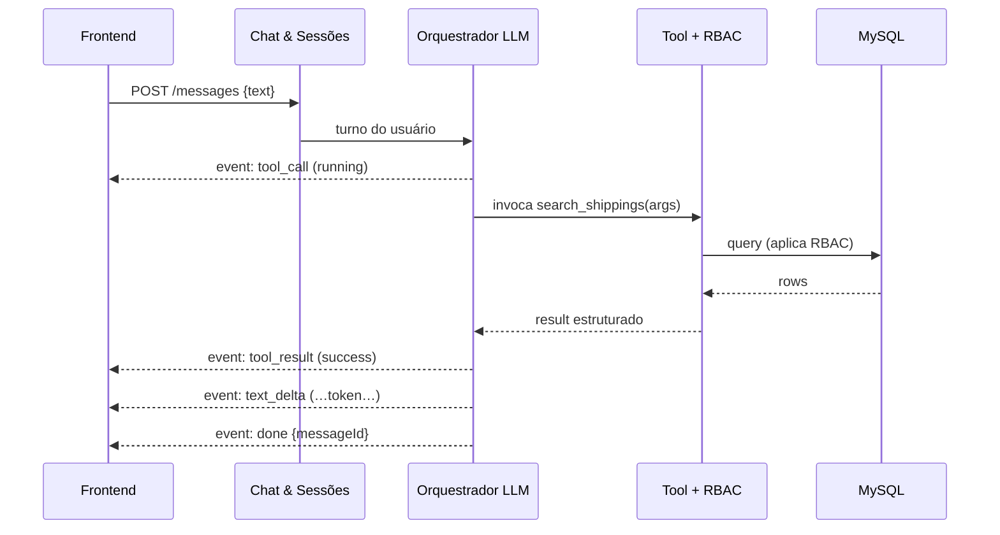
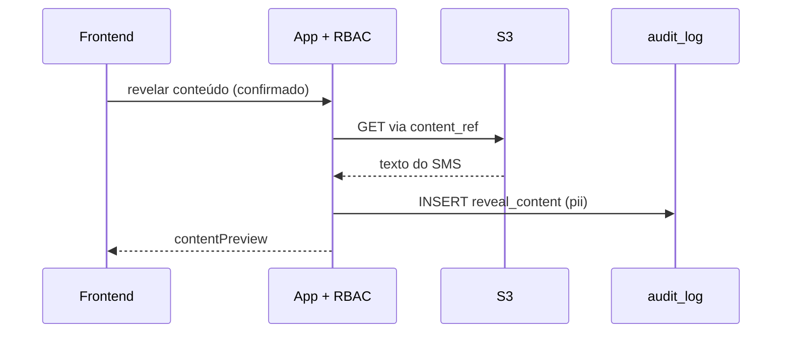
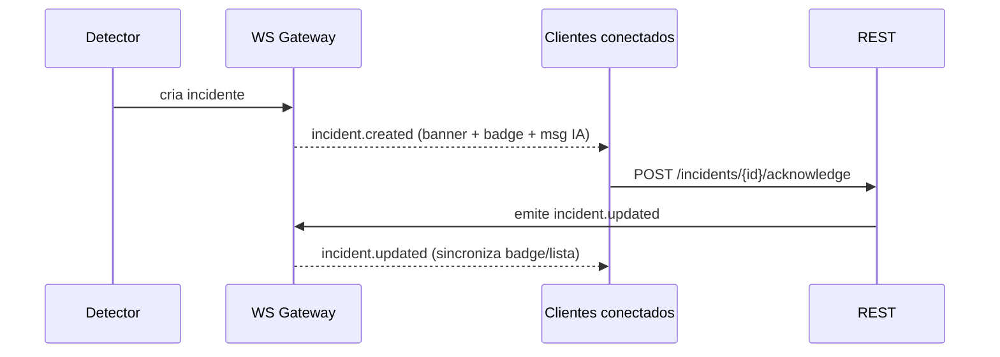

## Data Flow & Integrations

Este documento descreve como os dados deverão se mover pela Atena. **Importante:** não há código de produção ainda — só o handoff e o protótipo de referência em [`docs/(protótipo original, não incluído)`](../../docs/(protótipo original, não incluído)). Os fluxos abaixo são a **direção pretendida** pelo handoff ([01](../../docs/design_handoff_atena/01-backend-api-contract.md), [03](../../docs/design_handoff_atena/03-websocket-events.md), [04](../../docs/design_handoff_atena/04-screen-to-endpoint-map.md)), com os shapes ancorados nos mocks de `prototype/data.jsx` (que são o contrato).

A entrada principal de dados é a mensagem em linguagem natural do analista no chat. Daí o orquestrador LLM decide se invoca uma tool. **A IA nunca acessa o banco**: ela só interpreta NL → tool; a aplicação executa a query, aplica RBAC e devolve o resultado estruturado. PII chega mascarada por padrão; revelar gera entry no audit log. Na Fase 2, há também uma entrada *server-push*: o detector de anomalias cria incidentes que chegam ao cliente por WebSocket.

> **Atualização (2026-06-18) — motor de consulta de auditoria (S3 = fonte de verdade).**
> O dado de ENTREGA não mora mais no MySQL. As tabelas `messages`/`message_events` foram
> **dropadas**; o `AuditQueryService` (token `AUDIT_QUERY`, DuckDB embarcado + cache `/tmp`)
> consulta os logs no **S3 sob demanda** (`at-api-logs-prod`, JSON.gz Hive), normalizando por
> destinatário (status `status-webhook-receiver` ⊕ envio `process-messages-sms` classificado por
> `log.level`). Os 6 pontos (search/trail/report/catálogo/detector/reveal-análise) leem por aí;
> `correlation_id` e janela (`date_from`/`date_to`/`date_range`) são filtros. **MySQL = só dado da
> app** (chat, incidentes, regras, audit log). Detalhe: `.context/plans/audit-query-engine.md`.
> As seções abaixo descrevem o modelo anterior (hot store em MySQL) — mantidas como histórico.

> **Atualização (2026-06-23) — semântica de JANELA: por envio vs. por desfecho.**
> O `materialize` agrega os eventos do detailed report em `atena_records` por destinatário, com
> `requested_at` = `min(processed_at)` (instante do `queued`/envio) e `finalized_at` = instante do
> desfecho. Como o desfecho pode chegar até ~48h **depois** do envio, o scan das partições é
> **SIMÉTRICO** (`symmetricScanWindow`, ±`lateStatusBufferMs`): pra frente capta status tardios; pra
> trás capta o `queued` de um envio cujo desfecho caiu na janela mas o envio foi antes do `from` — sem
> o recuo, `requested_at` colapsava pro desfecho e o envio aparecia na janela ERRADA.
> Cada consumidor escolhe DELIBERADAMENTE o eixo da janela:
> - **Busca / Relatório** filtram por **`requested_at` (ENVIO)** — visão de COORTE: "como foi o lote
>   que mandei no dia X" (envios feitos na janela; mostra também se/quando finalizaram). Fonte única
>   da janela: `resolveWindow` (fuso do operador, `date_to` cobre o dia inteiro).
> - **Detector — regras de TAXA** (`delivery_rate_drop`, `failure_spike`, `consistent_error`) leem
>   `terminalSamples`, que filtra por **`finalized_at` (DESFECHO)** — visão de TEMPO REAL: "o que está
>   falhando AGORA". Por janelar pelo desfecho (e não ler `requested_at`), são IMUNES ao colapso do
>   `requested_at`; uma mensagem enviada ontem que falha hoje conta como falha de HOJE (correto p/
>   alerta). Janelar por envio perderia o pico de falhas tardias.
> - **Detector — `webhook_silence`** lê `sendSamples`, que filtra por **`requested_at` (ENVIO)** — é o
>   único path do detector sensível ao tempo do envio; usa o MESMO `materialize` (scan simétrico),
>   então o `requested_at` reflete o `queued` real.
> Resumo: detector de incidente = por DESFECHO (exceto webhook_silence); busca/relatório = por ENVIO.

> **Atualização (2026-06-25) — canal (SMS Short + Flash) e `app_id`.**
> O `CHANNEL_FILTER` passou de `campaign_type = 'sms'` para `IN ('sms', 'sms_flash')` — **decisão revista:
> cobrimos SMS Short E SMS Flash** (voz/RCS seguem fora). O `channel` (= `campaign_type`) e o `app_id`
> (aplicação que originou o envio; UUID no detailed report) agora são **lidos do bucket, materializados
> em `atena_records` e expostos nos fluxos** (busca, trilha, export CSV, e ao LLM) — o operador
> distingue o canal e a aplicação. Mudança de canal = editar a lista do `IN` em `audit-query.sql.ts`.
> Bump de `EV_CACHE_VERSION` (v8→v9) ao mudar o schema/`CHANNEL_FILTER` do `ev` (o cache parquet antigo
> não tem `app_id` nem o Flash).

## Module Dependencies

Dependências entre módulos pretendidos (direção, não implementadas):

- **Chat & Sessões** → `Orquestrador LLM`, `chat_sessions`/`chat_messages` (MySQL)
- **Orquestrador LLM** → `Amazon Bedrock`, `Catálogo de tools` (nunca o banco diretamente)
- **Catálogo de tools** → `Guards RBAC`, `messages`/`message_events`/`incidents` (MySQL), `S3` (via `content_ref`)
- **WS Gateway** → `incidents` (MySQL), `Detector de anomalias`
- **Acknowledge/Resolve (REST, UI-only)** → `incidents`, `incident_activity`, `Interceptor de audit`
- **Interceptor de audit (global)** → `audit_log` (append-only)
- **Todos os endpoints** → `Guards Auth/RBAC` (login social institucional (OIDC, domínio restrito); SSO corporativo completo é débito residual, ver [tech-debt.md](./tech-debt.md))

## Service Layer

Não existem classes de serviço de produção. Os serviços pretendidos (do contrato [01](../../docs/design_handoff_atena/01-backend-api-contract.md)) e seus análogos de referência no protótipo:

- **ChatSessionService** (pretendido) — referência: [`prototype/chat.jsx`](../../(protótipo original, não incluído)) (Composer, ToolCallPill, RefusalCard).
- **ToolService / catálogo** (pretendido) — referência: [`prototype/tool-results.jsx`](../../(protótipo original, não incluído)) (`SearchResults`, `TrailTimeline`, `RiskCard`, `ContentRevealBox`, `PhoneCell`, `useMaskedPhone`).
- **IncidentService** (pretendido) — referência: [`prototype/incidents.jsx`](../../(protótipo original, não incluído)) (lista, detalhe, banner, ResolveModal).
- **AuditService / interceptor** (pretendido) — referência: [`prototype/audit.jsx`](../../(protótipo original, não incluído)).
- **RulesService** (pretendido) — referência: [`prototype/rules.jsx`](../../(protótipo original, não incluído)).

## High-level Flow

### Fluxo 1 — Chat (mensagem do usuário → stream SSE)

O cliente faz `POST /api/chat/sessions/{id}/messages` com `{ "text": "..." }`. A resposta é um **stream** (SSE / chunked) na sequência:

```
event: tool_call    data: { "name": "search_shippings", "args": {...}, "status": "running" }
event: tool_result  data: { "name": "search_shippings", "status": "success", "result": {...} }
event: text_delta   data: { "delta": "Encontrei 6 envios…" }   // token a token
event: done         data: { "messageId": "...", "refusal": null }
```

Se o pedido for fora de escopo, em vez de `tool_call` o stream emite uma recusa (princípio "LLM não fabrica dados"):

```
event: refusal  data: { "reason": "fora_de_escopo", "explanation": "...", "canDo": [...] }
```

No frontend isso vira: `ToolCallPill` ("Buscando envios…") → render do resultado de tool → texto da IA streamando token a token → ou `RefusalCard` quando há recusa.



### Fluxo 2 — Tool determinística (ex.: `search_shippings` → MySQL)

O orquestrador chama `search_shippings` com `{ phone?, shippingId?, dateRange, status?, provider?, customerId?, limit, page }`. A aplicação (não o LLM) executa `GET /api/shippings/search` contra a tabela `messages`, aplicando os guards de RBAC. Retorna o envelope paginado `{ rows, page, totalPages, total, latencyMs }`, com cada linha no shape §C.1: `phoneMasked` sempre presente, `phoneFull` só com permissão + reveal. A tool call em si gera audit (`action: 'tool_call'`). `get_shipping_trail` segue o mesmo padrão contra `messages` + `message_events` (shape §C.2 com a timeline de `event.type` ∈ `api_request | routing | provider_attempt | webhook_status | final`).

### Fluxo 3 — Reveal de PII (mascarado → confirmação → S3 → audit)

Por padrão, telefone e conteúdo chegam mascarados (`useMaskedPhone`, `phoneMasked`, `contentPreview` ausente). Ao revelar:

1. **Reveal de telefone** (`PhoneCell`): retorna `phoneFull` e escreve audit `reveal_phone` (severity `pii`).
2. **Reveal de conteúdo** (`ContentRevealBox`): exige **confirmação** explícita. A aplicação lê primeiro o **cache transitório (read-through) dos dados brutos** — arquivos temporários no `/tmp` (volume Docker numa EC2); se o conteúdo/trilha não estiver lá, **busca no bucket S3** via `s3_log_pointer`/`contentRef` (ex.: `s3://at-msg-content/2026/05/28/4f3a2b1c-1111.txt`), popula o `/tmp` e escreve audit `reveal_content`. O `/tmp` é cache efêmero/rebuildável; o conteúdo bruto durável vive no S3 (o MySQL só guarda metadados e o ponteiro).



### Fluxo 4 — Incidente (Fase 2)

O **detector** de anomalias (começa via webhook do Grafana Alertmanager) cria um registro em `incidents` e o WS gateway emite `incident.created` a todos os usuários conectados. No frontend isso vira **três coisas**: um **banner persistente** no topo do chat, um **badge** na navegação e uma **mensagem da IA** no chat (som opcional por preferência do usuário).

`acknowledge`/`resolve` **não são tools do LLM** — vão por REST (`POST /api/incidents/{id}/acknowledge|resolve`) com validação server-side (categoria obrigatória, `actionDescription` ≥ 20 chars / ≥ 10 no auto_resolved, `escalatedTo` obrigatório se `*_escalated`, transição de estado válida). Cada mudança escreve em `incident_activity` (status_change) + audit log e o servidor emite `incident.updated` para os demais clientes. Quando a métrica volta à baseline sem ação, o detector emite `incident.auto_resolved`.



### Fluxo 5 — Reconexão WebSocket

O cliente conecta em `WS /ws/support` com o token/sessão OIDC (login social institucional) no handshake (query `?token=` ou header `Authorization` no upgrade); o WS valida esse token e conexão sem token válido é rejeitada. (Auth via login social institucional (OIDC, domínio restrito); SSO corporativo completo é débito residual, ver [tech-debt.md](./tech-debt.md).) Em queda de conexão, exibe uma faixa de aviso persistente e reconecta com **backoff exponencial (1s, 2s, 4s, … cap 30s)**. Ao reconectar, faz `GET /api/incidents?status=detected,acknowledged` para repreencher o estado — não confia só no stream, pois eventos podem ter sido perdidos durante a queda. Heartbeat opcional via `connection.status`.

## Internal Movement

A colaboração entre módulos é majoritariamente **síncrona via DI** dentro do monólito NestJS (chat → orquestrador → tool → repositório). Dois canais assíncronos importantes:

- **Streaming SSE** do orquestrador para o cliente (eventos incrementais do chat).
- **Push WebSocket** do gateway para os clientes (eventos de incidente), alimentado pelo detector.

O audit log é alimentado de forma transversal por um **interceptor global** que observa toda ação auditável, independentemente do módulo de origem.

## External Integrations

- **Amazon Bedrock (modelo Nova Pro via Bedrock, Converse API, streaming + tool use)** — orquestração com tool use + streaming. O orquestrador roda as tools; a IA nunca acessa o banco. Preferir cliente sem retenção de prompt (*decisão pendente*).
- **MySQL (hot store de metadados)** — metadados estruturados (retenção 90d; audit log 1 ano). Acesso via Prisma (snake_case no DB, camelCase na API). Guarda os metadados duráveis; o conteúdo/trilha volumoso **não** mora aqui — fica no cache transitório de `/tmp` e tem origem no S3.
- **Cache transitório de conteúdo/trilha (`/tmp`)** — dados brutos volumosos derivados dos logs materializados como arquivos temporários no `/tmp` do host, montado como volume Docker (deploy pretendido: imagem Docker numa EC2). Cache transitório (read-through) dos dados brutos: lê do `/tmp`; se faltar, busca no S3 (`s3_log_pointer`/`content_ref`) e popula o `/tmp`. Propósito: (a) evitar muitas requisições ao S3 num curto período e (b) manter os dados brutos fora do banco (não onerar o MySQL). Cache efêmero/rebuildável — nada que precise sobreviver a restart/redeploy mora só aqui.
- **S3** — conteúdo de SMS/PII (via `content_ref`) e logs `json.gz` (~100 GB/mês); **origem durável**. Toda leitura de conteúdo é logada. Popula o cache transitório de `/tmp` quando o dado pedido não está nele. **Athena** para janelas além da retenção.
- **Auth (Acme)** — login social institucional (OIDC) + RBAC: OIDC via Microsoft 365 (Entra ID), atrás de uma abstração de auth para trocar de IdP facilmente (ex.: Google Workspace), restrito ao domínio `@example.com`, sem senha própria. O token/sessão OIDC vai no Bearer de todos os endpoints REST e é validado no handshake WS. SSO corporativo completo (SAML + SCIM) é débito residual, ver [tech-debt.md](./tech-debt.md).
- **Grafana Alertmanager (Fase 2)** — webhook que alimenta o detector de anomalias → cria incidente.
- **OpenTelemetry / Prometheus** — métricas reais que alimentam `GET /api/observability`.

## Observability & Failure Modes

`GET /api/observability` expõe a saúde do próprio assistente: sessões, tokens, custo, MTTA, latência por tool (p50/p95/p99), erros por tool, consumo de tokens por hora, status do WebSocket e contagem de recusas por motivo — alimentado de OpenTelemetry/Prometheus.

Modos de falha e tratamento (do protótipo `error-states.jsx` e [04](../../docs/design_handoff_atena/04-screen-to-endpoint-map.md)):

- **Tool timeout/falha**: tool result com erro → `ToolError` inline no chat + botão "tentar de novo".
- **WebSocket desconectado**: faixa persistente + reconexão com backoff exponencial (cap 30s) + re-fetch de `GET /api/incidents?status=detected,acknowledged`.
- **Sessão expirada (401)**: overlay full-screen → re-login via login social institucional (OIDC, domínio restrito).
- **Recusa do LLM**: `refusal` no stream (fail-closed quando não há tool aplicável).
- **Validação de resolve**: revalidada server-side mesmo que a UI já desabilite o botão (validação dupla).

## Cross-References

- [Architecture Notes](./architecture.md)
- [Glossary & Domain Concepts](./glossary.md)
- Handoff: [01 — API Contract](../../docs/design_handoff_atena/01-backend-api-contract.md) · [03 — WebSocket Events](../../docs/design_handoff_atena/03-websocket-events.md) · [04 — Screen→Endpoint Map](../../docs/design_handoff_atena/04-screen-to-endpoint-map.md)
