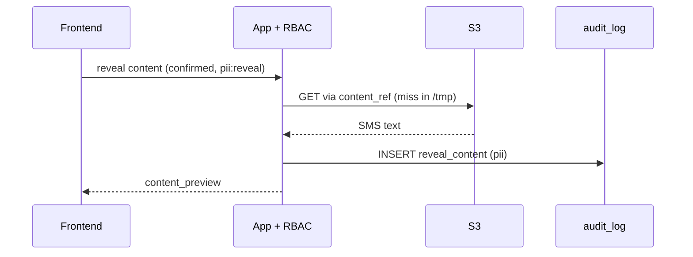
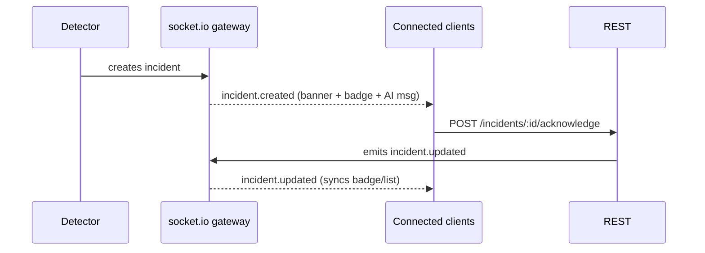

## Data Flow & Integrations

This document describes how data moves through Atena (MVP implemented). The shapes live in `@atena/types`; the API serializes in **`snake_case`** at the edge.

The main data input is the analyst's natural-language message in the chat. From there the LLM orchestrator decides whether to invoke a tool. **The AI never accesses the database**: it only interprets NL → tool; the application runs the query, applies RBAC and returns the structured result. PII arrives masked by default; revealing it requires `pii:reveal` and creates an audit log entry. There is also a *server-push* input: the anomaly detector creates incidents that reach the client over **socket.io** (`/ws/support`).

> **DELIVERY data = detailed report in S3 (source of truth).**
> DELIVERY data **does not live in MySQL** — `messages`/`message_events` were **dropped**.
> `DuckDbAuditQueryService` (token `AUDIT_QUERY`, embedded DuckDB + parquet cache in `/tmp`)
> queries the **detailed report in S3 on demand** (`s3://example-sms-delivery-reports`, Hive-partitioned JSON.gz, from the
> webhook-dispatcher), aggregating per recipient into `atena_records`. The consumers
> (search/trail/report/catalog/detector/reveal-analysis) read through it; the window
> (`date_from`/`date_to`/`date_range`) and the filters are parameters. **MySQL = app data only** (chat,
> incidents, rules, audit log, users/roles). Details: the `audit-query-engine` plan (formerly at `.context/plans/audit-query-engine.md`, no longer in the repository).

> **Update (2026-06-23) — WINDOW semantics: by send vs. by outcome.**
> `materialize` aggregates the detailed report events into `atena_records` per recipient, with
> `requested_at` = `min(processed_at)` (the instant of the `queued`/send) and `finalized_at` = the instant of the
> outcome. Since the outcome can arrive up to ~48h **after** the send, the partition scan is
> **SYMMETRIC** (`symmetricScanWindow`, ±`lateStatusBufferMs`): forward, it captures late statuses; backward,
> it captures the `queued` of a send whose outcome fell inside the window but whose send happened before `from` — without
> the look-back, `requested_at` collapsed onto the outcome and the send showed up in the WRONG window.
> Each consumer DELIBERATELY chooses the window axis:
> - **Search / Report** filter by **`requested_at` (SEND)** — a COHORT view: "how did the batch
>   I sent on day X go" (sends made within the window; also shows whether/when they finalized). Single source
>   of the window: `resolveWindow` (operator's time zone, `date_to` covers the whole day).
> - **Detector — RATE rules** (`delivery_rate_drop`, `failure_spike`, `consistent_error`) read
>   `terminalSamples`, which filters by **`finalized_at` (OUTCOME)** — a REAL-TIME view: "what is
>   failing NOW". Because they window by outcome (and do not read `requested_at`), they are IMMUNE to the
>   `requested_at` collapse; a message sent yesterday that fails today counts as TODAY's failure (correct for
>   alerting). Windowing by send would miss the spike of late failures.
> - **Detector — `webhook_silence`** reads `sendSamples`, which filters by **`requested_at` (SEND)** — it is the
>   only detector path sensitive to send time; it uses the SAME `materialize` (symmetric scan),
>   so `requested_at` reflects the real `queued`.
> Summary: incident detector = by OUTCOME (except webhook_silence); search/report = by SEND.

> **Update (2026-06-25) — channel (SMS Short + Flash) and `app_id`.**
> `CHANNEL_FILTER` went from `campaign_type = 'sms'` to `IN ('sms', 'sms_flash')` — **revised decision:
> we cover SMS Short AND SMS Flash** (voice/RCS remain out). The `channel` (= `campaign_type`) and the `app_id`
> (the application that originated the send; a UUID in the detailed report) are now **read from the bucket, materialized
> into `atena_records` and exposed in the flows** (search, trail, CSV export, and to the LLM) — the operator
> can tell the channel and the application apart. Changing channels = editing the `IN` list in `audit-query.sql.ts`.
> Bump `EV_CACHE_VERSION` (v8→v9) when changing the `ev` schema/`CHANNEL_FILTER` (the old parquet cache
> has neither `app_id` nor Flash).

## Module Dependencies

Dependencies between modules (`apps/api/src`):

- **Chat & Sessions** (`chat`) → `LLM orchestrator`, `chat_sessions`/`chat_messages` (MySQL)
- **LLM orchestrator** (`chat`/`llm`) → `Amazon Bedrock` (Nova Pro) or fake, `Tool catalog` (never the database directly)
- **Tool catalog** (`shippings`/`catalog`/`reports`/`incidents`) → `RBAC/permissions guards`, `AuditQueryService` (S3 via DuckDB + `/tmp` cache), `incidents` (MySQL)
- **socket.io gateway** (`realtime`) → `incidents` (MySQL), `Anomaly detector`
- **Acknowledge/Resolve (REST, UI-only)** (`incidents`) → `incidents`, `incident_activity`, `Audit interceptor`
- **Detector** (`detector`) → `AuditQueryService`, `anomaly_rules` (MySQL), creates `incidents`, notifies via `realtime`
- **Audit interceptor (global)** (`audit`) → `audit_log` (append-only)
- **Admin/Users** (`admin`/`users`) → `users`/`user_roles` (MySQL), `audit_log`
- **All endpoints** → `AuthGuard` + permissions guard (`@Requires`); roles read from the database

## Service Layer

Implemented services (`apps/api/src`):

- **OrchestratorService** (`chat/orchestrator.service.ts`) — tool-use loop, SSE stream, refusal; `ThinkingSplitter` separates `<thinking>`.
- **LlmProvider** (`llm/`) — `BedrockProvider` (Nova Pro via Converse) or `FakeLlmProvider`.
- **ShippingsService / AnalysisService / RevealService** (`shippings/`) — search/trail, risk analysis, audited PII reveal.
- **DuckDbAuditQueryService** (`audit-query/`, token `AUDIT_QUERY`) — queries the detailed report in S3 via DuckDB + `/tmp` cache.
- **IncidentService / IncidentLifecycleService** (`incidents/`) — read + lifecycle (ack/resolve/comment) with server-side validation.
- **DetectorService** (`detector/`) — anomaly rules, shadow mode, auto-resolve.
- **RulesService** (`rules/`) — CRUD of `anomaly_rules` (incl. `shadow_mode`); each edit creates a `rule_update`.
- **AuditService / interceptor** (`audit/`) — `@Audit` + append-only writes.
- **UsersService / AdminService** (`users/`, `admin/`) — identity, roles, status.
- **MetricsService** (`observability/`) — DogStatsD (optional).

## High-level Flow

### Flow 1 — Chat (user message → SSE stream)

The client sends `POST /api/chat/sessions/{id}/messages` with `{ "text": "..." }`. The response is a **stream** (SSE / chunked) in the sequence:

```
event: tool_call    data: { "name": "search_shippings", "args": {...}, "status": "running" }
event: tool_result  data: { "name": "search_shippings", "status": "success", "result": {...} }
event: text_delta   data: { "delta": "Encontrei 6 envios…" }   // token by token
event: done         data: { "message_id": "...", "refusal": null }
```

If the request is out of scope, instead of `tool_call` the stream emits a refusal (the "LLM does not fabricate data" principle):

```
event: refusal  data: { "reason": "fora_de_escopo", "explanation": "...", "can_do": [...] }
```

On the frontend this becomes: `ToolCallPill` ("Buscando envios…", i.e. "Searching shipments…") → rendering of the tool result → the AI's text streaming token by token → or `RefusalCard` when there is a refusal.

```mermaid
sequenceDiagram
    participant FE as Frontend
    participant CHAT as Chat & Sessions
    participant ORCH as LLM orchestrator
    participant T as Tool + RBAC
    participant AQ as AuditQueryService (DuckDB→S3)
    FE->>CHAT: POST /messages {text}
    CHAT->>ORCH: user turn
    ORCH-->>FE: event: tool_call (running)
    ORCH->>T: invokes search_shippings(args)
    T->>AQ: query (applies RBAC; /tmp read-through, S3 origin)
    AQ-->>T: rows
    T-->>ORCH: structured result
    ORCH-->>FE: event: tool_result (success)
    ORCH-->>FE: event: text_delta (…token…)
    ORCH-->>FE: event: done {message_id}
```

### Flow 2 — Deterministic tool (e.g. `search_shippings` → S3 via DuckDB)

The orchestrator calls `search_shippings` with `{ phone?, shipping_id?, date_range, date_from?, date_to?, status?, provider?, customer_id?, channel?, app_id?, limit, page }`. The application (not the LLM) executes `GET /api/shippings/search` via `AuditQueryService` (DuckDB over the detailed report in S3, `/tmp` cache), applying the permission guards. It returns the paginated envelope `{ rows, page, total_pages, total, latency_ms }`: `phone` always masked; the clear-text phone only through a reveal (`pii:reveal`). The tool call creates an audit entry (`action: 'tool_call'`). `get_shipping_trail` follows the same pattern (timeline with `type` ∈ `api_request | routing | provider_attempt | webhook_status | final`). Window by **send** (`requested_at`), symmetric scan ±`lateStatusBuffer`.

### Flow 3 — PII reveal (masked → confirmation → S3 → audit)

By default, phone and content arrive masked (`phone` masked, `content_preview` absent). When revealing (requires the `pii:reveal` permission):

1. **Phone reveal** (`POST /shippings/:id/reveal-phone`): returns the clear-text phone and writes the audit entry `reveal_phone` (severity `pii`).
2. **Content reveal** (`POST /shippings/:id/reveal-content`): requires explicit **confirmation**. The application first reads the **transient (read-through) cache** in `/tmp`; if the content is not there, it **fetches from S3** via `content_ref`, populates `/tmp` and writes the audit entry `reveal_content`. `/tmp` is an ephemeral/rebuildable cache; the durable raw content lives in S3.



### Flow 4 — Incident

The anomaly **detector** (scheduled scan `DETECT_ENABLED` or dev trigger `POST /api/dev/detect`) creates a record in `incidents` (with `related_shipping_ids`) and the socket.io gateway emits `incident.created` to connected users — **unless** the rule is in **shadow mode** (records `shadow=true`, does not notify). On the frontend this becomes a **persistent banner**, a **badge** in the navigation and an **AI message** in the chat.

`acknowledge`/`resolve`/`comment` **are not LLM tools** — they go through REST (`POST /api/incidents/:id/acknowledge|resolve|comment`) with server-side validation (mandatory category, `action_description` ≥ 20 chars / ≥ 10 for auto_resolved, `escalated_to` mandatory if `*_escalated`, valid state transition). Each change writes to `incident_activity` (status_change) + the audit log, and the server emits `incident.updated`. When the metric returns to baseline without action, the detector emits `incident.auto_resolved`.



### Flow 5 — socket.io reconnection

The client connects to `/ws/support` (socket.io); the handshake is authenticated by the **JWT cookie session** (`atena_session`) — a connection without a valid identity is rejected (in dev, `AUTH_DEV_BYPASS` accepts it without a cookie). When the connection drops, it shows a persistent warning strip and `socket.io-client` reconnects with backoff. On reconnect, it calls `GET /api/incidents?status=detected,acknowledged` to refill the state — it does not rely on the stream alone, since events may have been lost. Heartbeat via `connection.status`.

## Internal Movement

Collaboration between modules is mostly **synchronous via DI** inside the NestJS monolith (chat → orchestrator → tool → AuditQueryService/Prisma). Two important asynchronous channels:

- **SSE streaming** from the orchestrator to the client (incremental chat events).
- **socket.io push** from the gateway to the clients (incident events), fed by the detector.

The audit log is fed transversally by a **global interceptor** (`@Audit`) that observes every auditable action, regardless of the originating module.

## External Integrations

- **Amazon Bedrock (Amazon Nova Pro `us.amazon.nova-pro-v1:0`, Converse API, streaming + tool use)** — orchestration with tool use + streaming. Auth via `AWS_BEARER_TOKEN_BEDROCK` (or the EC2 IAM role). No credentials → deterministic `FakeLlmProvider`. The orchestrator runs the tools; the AI never accesses the database.
- **S3 (`s3://example-sms-delivery-reports`)** — SMS detailed report (**delivery source of truth**) + raw content/PII; **durable origin**. Queried by DuckDB on demand; populates the transient `/tmp` cache. Every content read is logged.
- **Transient cache (`/tmp`)** — raw data derived from the detailed report, materialized as parquet in `/tmp` (a Docker volume on an EC2 instance in prod). Read-through: reads from `/tmp`; on a miss, fetches from S3 and populates it. Ephemeral/rebuildable; eviction by age+size.
- **MySQL (application data)** — chat, incidents, rules, audit log, users/roles. Access via Prisma (snake_case in the DB). Delivery data does **not** live here.
- **Auth (Microsoft Entra)** — OIDC (state/nonce/PKCE) via Microsoft 365 (Entra ID), behind `IdentityProviderInterface` (IdP-swappable), restricted to `@example.com`, with no password of its own. JWT cookie session validated on REST endpoints and at the socket.io handshake. Roles read from the database. Full SSO (SAML + SCIM) is residual debt, see [tech-debt.md](./tech-debt.md).
- **Datadog (optional)** — APM via dd-trace + metrics via DogStatsD (hot-shots); feeds `GET /api/observability`. Opt-in (`make datadog`).

## Observability & Failure Modes

`GET /api/observability` exposes the health of the assistant itself: sessions, usage/latency per tool, tokens, cost, refusals and WS connections — metrics via DogStatsD/Datadog (optional). No PII.

Failure modes and handling:

- **Tool timeout/failure**: tool result with an error → inline `ToolError` in the chat + a "tentar de novo" ("try again") button.
- **socket.io disconnected**: persistent strip + reconnection with backoff + re-fetch of `GET /api/incidents?status=detected,acknowledged`.
- **Expired session (401)**: full-screen overlay → re-login via OIDC.
- **LLM refusal**: `refusal` in the stream (fail-closed when no tool applies).
- **Post-tool turn hang on Bedrock**: idle timeout (60s) turns the hang into a graceful `event: error` (see [tech-debt.md](./tech-debt.md)).
- **Resolve validation**: revalidated server-side even when the UI already disables the button (double validation).

## Cross-References

- [Architecture Notes](./architecture.md)
- [Glossary & Domain Concepts](./glossary.md)
- Handoff (historical reference): [01 — API Contract](../../docs/design_handoff_atena/01-backend-api-contract.md) · [03 — WebSocket Events](../../docs/design_handoff_atena/03-websocket-events.md)
