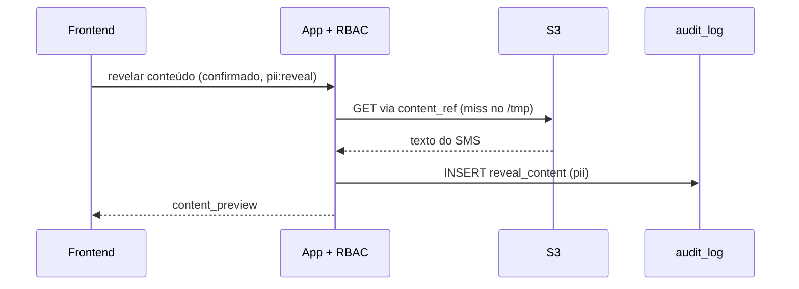
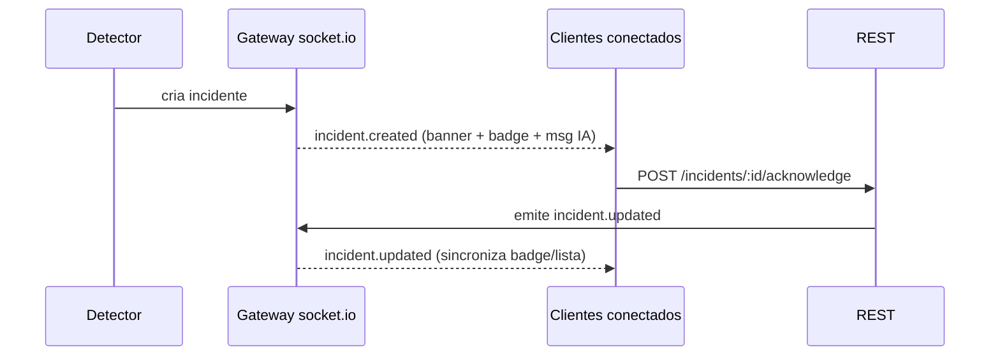

## Data Flow & Integrations

Este documento descreve como os dados se movem pela Atena (MVP implementado). Os shapes vivem em `@atena/types`; a API serializa em **`snake_case`** na borda.

A entrada principal de dados é a mensagem em linguagem natural do analista no chat. Daí o orquestrador LLM decide se invoca uma tool. **A IA nunca acessa o banco**: ela só interpreta NL → tool; a aplicação executa a query, aplica RBAC e devolve o resultado estruturado. PII chega mascarada por padrão; revelar exige `pii:reveal` e gera entry no audit log. Há também uma entrada *server-push*: o detector de anomalias cria incidentes que chegam ao cliente por **socket.io** (`/ws/support`).

> **Dado de ENTREGA = detailed report no S3 (fonte da verdade).**
> O dado de ENTREGA **não mora no MySQL** — `messages`/`message_events` foram **dropadas**.
> O `DuckDbAuditQueryService` (token `AUDIT_QUERY`, DuckDB embarcado + cache parquet no `/tmp`)
> consulta o **detailed report no S3 sob demanda** (`s3://example-sms-delivery-reports`, JSON.gz Hive, do
> webhook-dispatcher), agregando por destinatário em `atena_records`. Os pontos
> (search/trail/report/catálogo/detector/reveal-análise) leem por aí; janela
> (`date_from`/`date_to`/`date_range`) e filtros são parâmetros. **MySQL = só dado da app** (chat,
> incidentes, regras, audit log, usuários/papéis). Detalhe: `.context/plans/audit-query-engine.md`.

> **Atualização (2026-06-23) — semântica de JANELA: por envio vs. por desfecho.**
> O `materialize` agrega os eventos do detailed report em `atena_records` por destinatário, com
> `requested_at` = `min(processed_at)` (instante do `queued`/envio) e `finalized_at` = instante do
> desfecho. Como o desfecho pode chegar até ~48h **depois** do envio, o scan das partições é
> **SIMÉTRICO** (`symmetricScanWindow`, ±`lateStatusBufferMs`): pra frente capta status tardios; pra
> trás capta o `queued` de um envio cujo desfecho caiu na janela mas o envio foi antes do `from` — sem
> o recuo, `requested_at` colapsava pro desfecho e o envio aparecia na janela ERRADA.
> Cada consumidor escolhe DELIBERADAMENTE o eixo da janela:
> - **Busca / Relatório** filtram por **`requested_at` (ENVIO)** — visão de COORTE: "como foi o lote
>   que mandei no dia X" (envios feitos na janela; mostra também se/quando finalizaram). Fonte única
>   da janela: `resolveWindow` (fuso do operador, `date_to` cobre o dia inteiro).
> - **Detector — regras de TAXA** (`delivery_rate_drop`, `failure_spike`, `consistent_error`) leem
>   `terminalSamples`, que filtra por **`finalized_at` (DESFECHO)** — visão de TEMPO REAL: "o que está
>   falhando AGORA". Por janelar pelo desfecho (e não ler `requested_at`), são IMUNES ao colapso do
>   `requested_at`; uma mensagem enviada ontem que falha hoje conta como falha de HOJE (correto p/
>   alerta). Janelar por envio perderia o pico de falhas tardias.
> - **Detector — `webhook_silence`** lê `sendSamples`, que filtra por **`requested_at` (ENVIO)** — é o
>   único path do detector sensível ao tempo do envio; usa o MESMO `materialize` (scan simétrico),
>   então o `requested_at` reflete o `queued` real.
> Resumo: detector de incidente = por DESFECHO (exceto webhook_silence); busca/relatório = por ENVIO.

> **Atualização (2026-06-25) — canal (SMS Short + Flash) e `app_id`.**
> O `CHANNEL_FILTER` passou de `campaign_type = 'sms'` para `IN ('sms', 'sms_flash')` — **decisão revista:
> cobrimos SMS Short E SMS Flash** (voz/RCS seguem fora). O `channel` (= `campaign_type`) e o `app_id`
> (aplicação que originou o envio; UUID no detailed report) agora são **lidos do bucket, materializados
> em `atena_records` e expostos nos fluxos** (busca, trilha, export CSV, e ao LLM) — o operador
> distingue o canal e a aplicação. Mudança de canal = editar a lista do `IN` em `audit-query.sql.ts`.
> Bump de `EV_CACHE_VERSION` (v8→v9) ao mudar o schema/`CHANNEL_FILTER` do `ev` (o cache parquet antigo
> não tem `app_id` nem o Flash).

## Module Dependencies

Dependências entre módulos (`apps/api/src`):

- **Chat & Sessões** (`chat`) → `Orquestrador LLM`, `chat_sessions`/`chat_messages` (MySQL)
- **Orquestrador LLM** (`chat`/`llm`) → `Amazon Bedrock` (Nova Pro) ou fake, `Catálogo de tools` (nunca o banco diretamente)
- **Catálogo de tools** (`shippings`/`catalog`/`reports`/`incidents`) → `Guards RBAC/permissões`, `AuditQueryService` (S3 via DuckDB + cache `/tmp`), `incidents` (MySQL)
- **Gateway socket.io** (`realtime`) → `incidents` (MySQL), `Detector de anomalias`
- **Acknowledge/Resolve (REST, UI-only)** (`incidents`) → `incidents`, `incident_activity`, `Interceptor de audit`
- **Detector** (`detector`) → `AuditQueryService`, `anomaly_rules` (MySQL), cria `incidents`, notifica via `realtime`
- **Interceptor de audit (global)** (`audit`) → `audit_log` (append-only)
- **Admin/Users** (`admin`/`users`) → `users`/`user_roles` (MySQL), `audit_log`
- **Todos os endpoints** → `AuthGuard` + guard de permissões (`@Requires`); papéis lidos do banco

## Service Layer

Serviços implementados (`apps/api/src`):

- **OrchestratorService** (`chat/orchestrator.service.ts`) — loop de tool use, stream SSE, recusa; `ThinkingSplitter` separa `<thinking>`.
- **LlmProvider** (`llm/`) — `BedrockProvider` (Nova Pro via Converse) ou `FakeLlmProvider`.
- **ShippingsService / AnalysisService / RevealService** (`shippings/`) — busca/trilha, análise de risco, reveal de PII auditado.
- **DuckDbAuditQueryService** (`audit-query/`, token `AUDIT_QUERY`) — consulta o detailed report no S3 via DuckDB + cache `/tmp`.
- **IncidentService / IncidentLifecycleService** (`incidents/`) — read + ciclo de vida (ack/resolve/comment) com validação server-side.
- **DetectorService** (`detector/`) — regras de anomalia, shadow mode, auto-resolve.
- **RulesService** (`rules/`) — CRUD de `anomaly_rules` (incl. `shadow_mode`); cada edição gera `rule_update`.
- **AuditService / interceptor** (`audit/`) — `@Audit` + escrita append-only.
- **UsersService / AdminService** (`users/`, `admin/`) — identidade, papéis, status.
- **MetricsService** (`observability/`) — DogStatsD (opcional).

## High-level Flow

### Fluxo 1 — Chat (mensagem do usuário → stream SSE)

O cliente faz `POST /api/chat/sessions/{id}/messages` com `{ "text": "..." }`. A resposta é um **stream** (SSE / chunked) na sequência:

```
event: tool_call    data: { "name": "search_shippings", "args": {...}, "status": "running" }
event: tool_result  data: { "name": "search_shippings", "status": "success", "result": {...} }
event: text_delta   data: { "delta": "Encontrei 6 envios…" }   // token a token
event: done         data: { "message_id": "...", "refusal": null }
```

Se o pedido for fora de escopo, em vez de `tool_call` o stream emite uma recusa (princípio "LLM não fabrica dados"):

```
event: refusal  data: { "reason": "fora_de_escopo", "explanation": "...", "can_do": [...] }
```

No frontend isso vira: `ToolCallPill` ("Buscando envios…") → render do resultado de tool → texto da IA streamando token a token → ou `RefusalCard` quando há recusa.

```mermaid
sequenceDiagram
    participant FE as Frontend
    participant CHAT as Chat & Sessões
    participant ORCH as Orquestrador LLM
    participant T as Tool + RBAC
    participant AQ as AuditQueryService (DuckDB→S3)
    FE->>CHAT: POST /messages {text}
    CHAT->>ORCH: turno do usuário
    ORCH-->>FE: event: tool_call (running)
    ORCH->>T: invoca search_shippings(args)
    T->>AQ: query (aplica RBAC; /tmp read-through, S3 origem)
    AQ-->>T: rows
    T-->>ORCH: result estruturado
    ORCH-->>FE: event: tool_result (success)
    ORCH-->>FE: event: text_delta (…token…)
    ORCH-->>FE: event: done {message_id}
```

### Fluxo 2 — Tool determinística (ex.: `search_shippings` → S3 via DuckDB)

O orquestrador chama `search_shippings` com `{ phone?, shipping_id?, date_range, date_from?, date_to?, status?, provider?, customer_id?, channel?, app_id?, limit, page }`. A aplicação (não o LLM) executa `GET /api/shippings/search` via `AuditQueryService` (DuckDB sobre o detailed report no S3, cache `/tmp`), aplicando os guards de permissão. Retorna o envelope paginado `{ rows, page, total_pages, total, latency_ms }`: `phone` sempre mascarado; o telefone em claro só por reveal (`pii:reveal`). A tool call gera audit (`action: 'tool_call'`). `get_shipping_trail` segue o mesmo padrão (timeline com `type` ∈ `api_request | routing | provider_attempt | webhook_status | final`). Janela por **envio** (`requested_at`), scan simétrico ±`lateStatusBuffer`.

### Fluxo 3 — Reveal de PII (mascarado → confirmação → S3 → audit)

Por padrão, telefone e conteúdo chegam mascarados (`phone` mascarado, `content_preview` ausente). Ao revelar (exige permissão `pii:reveal`):

1. **Reveal de telefone** (`POST /shippings/:id/reveal-phone`): retorna o telefone em claro e escreve audit `reveal_phone` (severity `pii`).
2. **Reveal de conteúdo** (`POST /shippings/:id/reveal-content`): exige **confirmação** explícita. A aplicação lê primeiro o **cache transitório (read-through)** no `/tmp`; se o conteúdo não estiver lá, **busca no S3** via `content_ref`, popula o `/tmp` e escreve audit `reveal_content`. O `/tmp` é cache efêmero/rebuildável; o conteúdo bruto durável vive no S3.



### Fluxo 4 — Incidente

O **detector** de anomalias (scan agendado `DETECT_ENABLED` ou gatilho dev `POST /api/dev/detect`) cria um registro em `incidents` (com `related_shipping_ids`) e o gateway socket.io emite `incident.created` aos usuários conectados — **a menos que** a regra esteja em **shadow mode** (registra `shadow=true`, não notifica). No frontend isso vira um **banner persistente**, um **badge** na navegação e uma **mensagem da IA** no chat.

`acknowledge`/`resolve`/`comment` **não são tools do LLM** — vão por REST (`POST /api/incidents/:id/acknowledge|resolve|comment`) com validação server-side (categoria obrigatória, `action_description` ≥ 20 chars / ≥ 10 no auto_resolved, `escalated_to` obrigatório se `*_escalated`, transição de estado válida). Cada mudança escreve em `incident_activity` (status_change) + audit log e o servidor emite `incident.updated`. Quando a métrica volta à baseline sem ação, o detector emite `incident.auto_resolved`.



### Fluxo 5 — Reconexão socket.io

O cliente conecta em `/ws/support` (socket.io); o handshake é autenticado pela **sessão por cookie JWT** (`atena_session`) — conexão sem identidade válida é rejeitada (em dev, `AUTH_DEV_BYPASS` aceita sem cookie). Em queda de conexão, exibe uma faixa de aviso persistente e o `socket.io-client` reconecta com backoff. Ao reconectar, faz `GET /api/incidents?status=detected,acknowledged` para repreencher o estado — não confia só no stream, pois eventos podem ter sido perdidos. Heartbeat via `connection.status`.

## Internal Movement

A colaboração entre módulos é majoritariamente **síncrona via DI** dentro do monólito NestJS (chat → orquestrador → tool → AuditQueryService/Prisma). Dois canais assíncronos importantes:

- **Streaming SSE** do orquestrador para o cliente (eventos incrementais do chat).
- **Push socket.io** do gateway para os clientes (eventos de incidente), alimentado pelo detector.

O audit log é alimentado de forma transversal por um **interceptor global** (`@Audit`) que observa toda ação auditável, independentemente do módulo de origem.

## External Integrations

- **Amazon Bedrock (Amazon Nova Pro `us.amazon.nova-pro-v1:0`, Converse API, streaming + tool use)** — orquestração com tool use + streaming. Auth via `AWS_BEARER_TOKEN_BEDROCK` (ou IAM role da EC2). Sem credencial → `FakeLlmProvider` determinístico. O orquestrador roda as tools; a IA nunca acessa o banco.
- **S3 (`s3://example-sms-delivery-reports`)** — detailed report de SMS (**fonte da verdade da entrega**) + conteúdo bruto/PII; **origem durável**. Consultado por DuckDB sob demanda; popula o cache transitório de `/tmp`. Toda leitura de conteúdo é logada.
- **Cache transitório (`/tmp`)** — dados brutos derivados do detailed report materializados como parquet no `/tmp` (volume Docker numa EC2 em prod). Read-through: lê do `/tmp`; se faltar, busca no S3 e popula. Efêmero/rebuildável; eviction por idade+tamanho.
- **MySQL (dado da aplicação)** — chat, incidentes, regras, audit log, usuários/papéis. Acesso via Prisma (snake_case no DB). O dado de entrega **não** mora aqui.
- **Auth (Microsoft Entra)** — OIDC (state/nonce/PKCE) via Microsoft 365 (Entra ID), atrás de `IdentityProviderInterface` (trocável de IdP), restrito a `@example.com`, sem senha própria. Sessão por cookie JWT validada nos endpoints REST e no handshake socket.io. Papéis lidos do banco. SSO completo (SAML + SCIM) é débito residual, ver [tech-debt.md](./tech-debt.md).
- **Datadog (opcional)** — APM via dd-trace + métricas via DogStatsD (hot-shots); alimenta `GET /api/observability`. Opt-in (`make datadog`).

## Observability & Failure Modes

`GET /api/observability` expõe a saúde do próprio assistente: sessões, uso/latência por tool, tokens, custo, recusas e conexões WS — métricas via DogStatsD/Datadog (opcional). Sem PII.

Modos de falha e tratamento:

- **Tool timeout/falha**: tool result com erro → `ToolError` inline no chat + botão "tentar de novo".
- **Socket.io desconectado**: faixa persistente + reconexão com backoff + re-fetch de `GET /api/incidents?status=detected,acknowledged`.
- **Sessão expirada (401)**: overlay full-screen → re-login via OIDC.
- **Recusa do LLM**: `refusal` no stream (fail-closed quando não há tool aplicável).
- **Hang do turno pós-tool no Bedrock**: idle timeout (60s) converte o hang em `event: error` gracioso (ver [tech-debt.md](./tech-debt.md)).
- **Validação de resolve**: revalidada server-side mesmo que a UI já desabilite o botão (validação dupla).

## Cross-References

- [Architecture Notes](./architecture.md)
- [Glossary & Domain Concepts](./glossary.md)
- Handoff (referência histórica): [01 — API Contract](../../docs/design_handoff_atena/01-backend-api-contract.md) · [03 — WebSocket Events](../../docs/design_handoff_atena/03-websocket-events.md)
